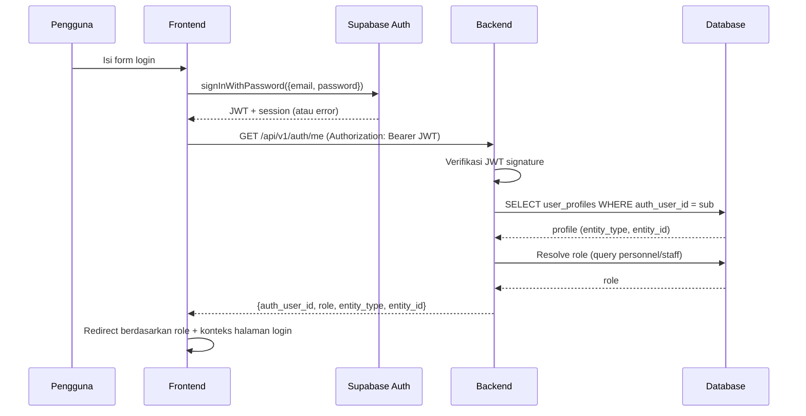
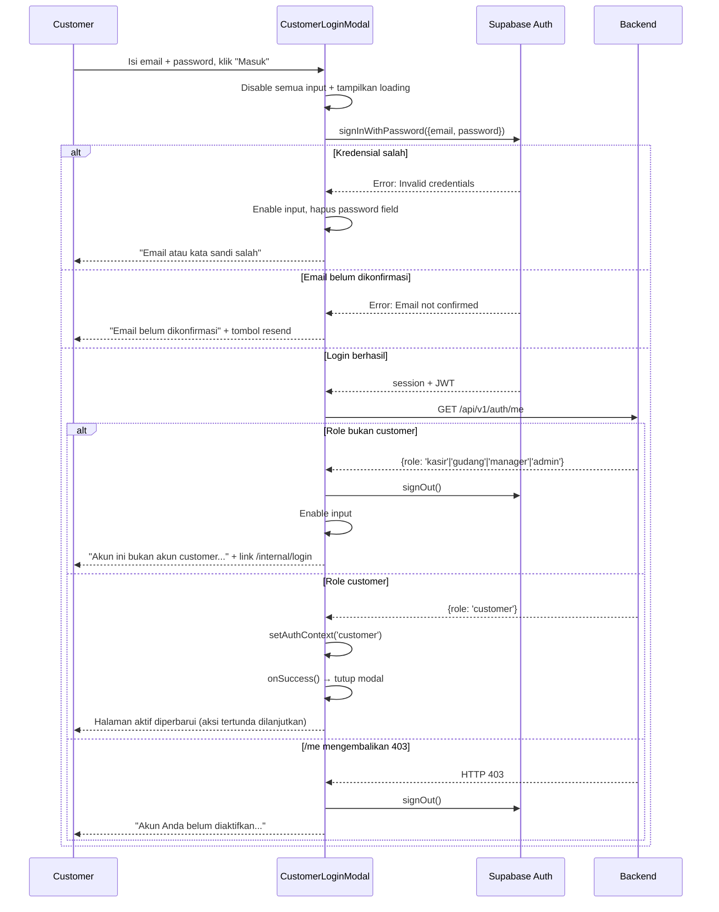
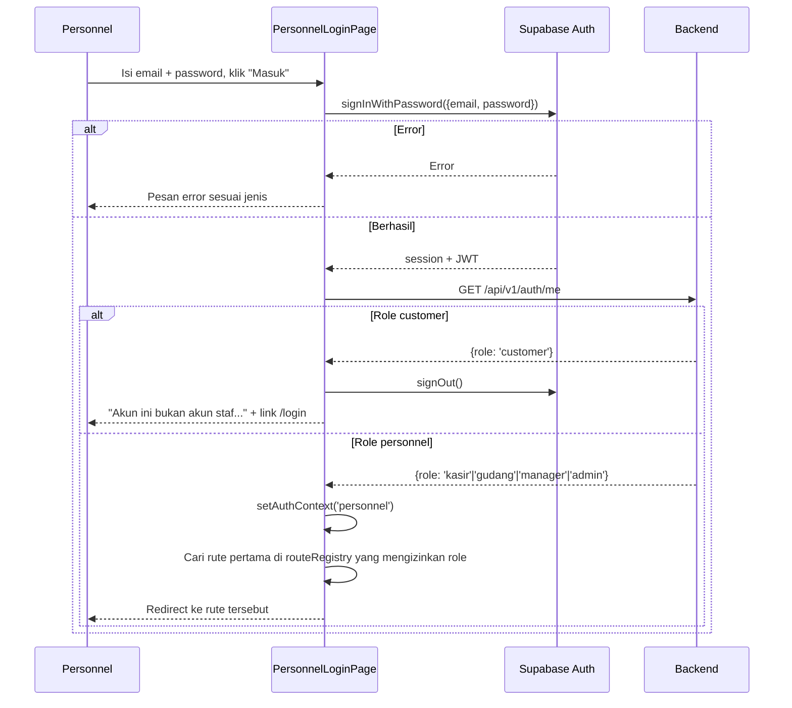
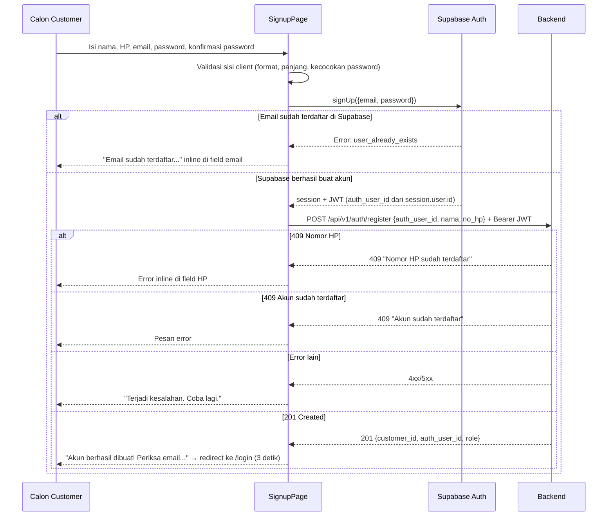
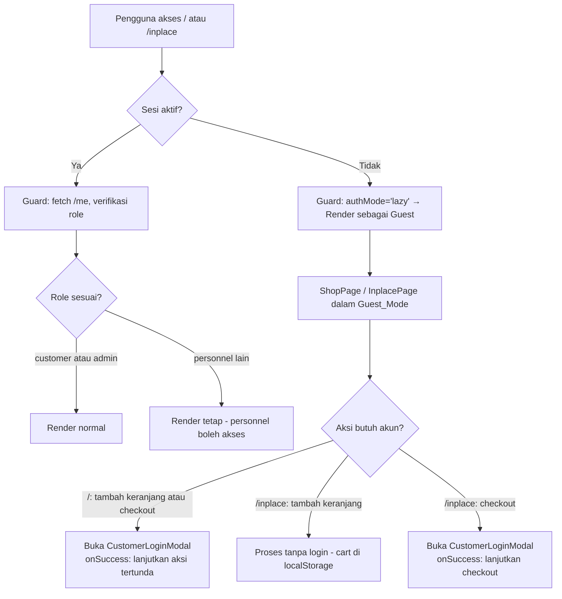
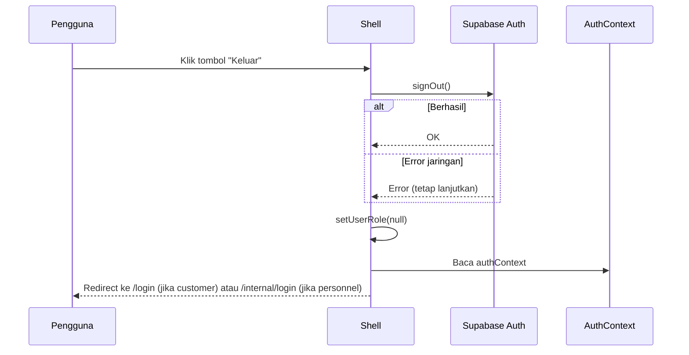

# Design Document: Foundation — Login & Signup

## Overview

Spec ini melengkapi lapisan autentikasi yang sudah dirintis di `platform-foundation`. Fondasi yang ada (Guard, Shell, routeRegistry, `get_current_user`, `require_role`) sudah berfungsi, namun masih kosong di beberapa titik:

- **Guard** hanya mengenal satu mode (redirect ke `/login` jika tidak ada sesi) dan satu URL login
- **Shell** belum punya tombol keluar
- **routes.tsx** hanya mendaftarkan `/login` (satu halaman generik), belum ada `/signup` dan `/internal/login`
- **LoginPage.tsx** tidak membedakan customer vs personnel
- **Backend** belum punya modul `auth` — endpoint `/me` dan `/register` belum ada

Spec ini menambahkan:
1. **`CustomerLoginModal`** — dialog yang muncul di atas halaman aktif tanpa navigasi URL, menggantikan halaman penuh `/login`
2. **`PersonnelLoginPage`** (`/internal/login`) dan **`SignupPage`** (`/signup`) sebagai rute publik baru
3. **Dua mode Guard**: `lazy` (guest diizinkan, login diminta on-demand) dan `hard` (wajib login sebelum akses)
4. **Tombol Keluar** di Shell dengan redirect context-aware (`/` vs `/internal/login`)
5. **Backend modul `auth`** dengan endpoint `GET /api/v1/auth/me` dan `POST /api/v1/auth/register`

Semua perubahan bersifat additive — tidak memutus fungsionalitas yang sudah berjalan di `platform-foundation`.

---

## Architecture

### Gambaran Umum

```
Browser
  │
  ├── /signup          → SignupPage
  ├── /internal/login  → PersonnelLoginPage
  │
  └── /* (protected)   → Guard (upgraded) → Shell (+ tombol Keluar) → halaman
                                ↕                          │
                         GET /api/v1/auth/me               │ (overlay, tanpa navigasi URL)
                                ↕                          ↓
                    FastAPI Backend (modul auth)    CustomerLoginModal
                                ↕
                   PostgreSQL (user_profiles, personnel, staff, customers)
```

### Alur Autentikasi

Semua jalur autentikasi berbasis Supabase Auth. Backend tidak mengurus session — hanya memverifikasi JWT dan menyediakan data profil dari database.



### Backend Module Structure

Modul baru `app/modules/auth/` mengikuti konvensi domain yang sama dengan modul TPS:

```
backend/app/modules/auth/
├── __init__.py
├── routes.py      # APIRouter prefix /api/v1/auth
├── service.py     # logika bisnis: register_customer
├── repository.py  # akses DB: create_customer, create_user_profile, get_user_profile_by_phone
└── schemas.py     # Pydantic: RegisterRequest, RegisterResponse, MeResponse
```

> **Tidak ada `models.py`** di modul auth karena model SQLAlchemy (`UserProfile`, `Personnel`, `Staff`) sudah didefinisikan di `app/core/dependencies.py`. Model `Customer` dan `ActivityLog` juga sudah ada di `app/core/`. Modul auth hanya mendefinisikan schemas Pydantic.

**Catatan:** `UserProfile` dan `Personnel`/`Staff` sudah ada di `core/dependencies.py`. `Customer` perlu ditambahkan sebagai SQLAlchemy model — letakkan di file baru `app/core/models.py` agar bisa dipakai lintas modul tanpa melanggar aturan dependency (core tidak import dari modules).

### Frontend File Changes

| File | Status | Perubahan |
|------|--------|-----------|
| `src/app/registry.ts` | ✏️ Modifikasi | Tambah field `authMode: 'lazy' \| 'hard'` ke `RouteConfig` dan semua entri |
| `src/app/Guard.tsx` | ✏️ Modifikasi | Upgrade untuk dua mode, URL login publik, AuthContext |
| `src/app/Shell.tsx` | ✏️ Modifikasi | Tambah tombol "Keluar" dengan redirect context-aware |
| `src/app/routes.tsx` | ✏️ Modifikasi | Rute `/signup`, `/internal/login`, dan `/login` (alternatif modal) |
| `src/app/App.tsx` | ✏️ Modifikasi | Bungkus dengan `AuthContextProvider` |
| `src/modules/auth/CustomerLoginModal.tsx` | 🆕 Baru | Dialog login customer (overlay pop-up, tanpa navigasi URL) |
| `src/modules/auth/LoginPage.tsx` | 🆕 Baru | Halaman login customer mandiri di `/login` (alternatif modal) |
| `src/modules/auth/PersonnelLoginPage.tsx` | 🆕 Baru | Halaman login personnel di `/internal/login` |
| `src/modules/auth/SignupPage.tsx` | 🆕 Baru | Halaman registrasi customer di `/signup` |
| `src/shared/auth-context-global.ts` | 🆕 Baru | AuthContext, types, dan global getter/setter |
| `src/shared/auth-context.tsx` | 🆕 Baru | Provider `AuthContextProvider` |
| `src/shared/use-auth-context.ts` | 🆕 Baru | Custom hook `useAuthContext()` |
| `src/modules/auth/CustomerLoginModal.test.tsx` | 🆕 Baru | Unit tests modal login customer |
| `src/modules/auth/LoginPage.test.tsx` | 🆕 Baru | Unit tests halaman login customer |
| `src/modules/auth/PersonnelLoginPage.test.tsx` | 🆕 Baru | Unit tests login personnel |
| `src/modules/auth/SignupPage.test.tsx` | 🆕 Baru | Unit tests registrasi customer |
| `src/app/Guard.test.tsx` | ✏️ Modifikasi | Update tests untuk dua mode |

---

## Components and Interfaces

### 1. RouteConfig (registry.ts) — Field Baru

```typescript
export interface RouteConfig {
  path: string;
  label: string;
  allowedRoles: string[];
  authMode: 'lazy' | 'hard'; // NEW: mode akses Guard
  component: LazyExoticComponent<ComponentType>;
}

export const routeRegistry: RouteConfig[] = [
  {
    path: "/",
    label: "Toko Online",
    allowedRoles: ["customer", "admin"],
    authMode: "lazy",   // Guest diizinkan (marketplace utama, /shop dialihkan ke /)
    component: lazy(() => import("../modules/tps/shop/ShopPage")),
  },
  {
    path: "/inplace",
    label: "Inplace Store",
    allowedRoles: ["customer", "admin"],
    authMode: "lazy",   // Guest diizinkan
    component: lazy(() => import("../modules/tps/inplace/InplacePage")),
  },
  {
    path: "/pos",
    label: "Kasir",
    allowedRoles: ["kasir", "manager", "admin"],
    authMode: "hard",   // Wajib login
    component: lazy(() => import("../modules/tps/pos/PosPage")),
  },
  {
    path: "/warehouse",
    label: "Gudang",
    allowedRoles: ["gudang", "manager", "admin"],
    authMode: "hard",   // Wajib login
    component: lazy(() => import("../modules/tps/warehouse/WarehousePage")),
  },
  {
    path: "/management",
    label: "Manajemen",
    allowedRoles: ["manager", "admin"],
    authMode: "hard",   // Wajib login
    component: lazy(() => import("../modules/tps/management/ManagementPage")),
  },
];
```

### 2. AuthContext (auth-context.tsx)

Context untuk menyimpan dari mana user login — dibutuhkan Shell saat logout untuk menentukan redirect.

```typescript
// src/shared/auth-context.tsx
type AuthContextValue = 'customer' | 'personnel' | null;

interface AuthContextType {
  authContext: AuthContextValue;
  setAuthContext: (ctx: AuthContextValue) => void;
}

export const AuthContext = createContext<AuthContextType>({
  authContext: null,
  setAuthContext: () => {},
});

export function AuthContextProvider({ children }: { children: React.ReactNode }) {
  const [authContext, setAuthContext] = useState<AuthContextValue>(null);
  return (
    <AuthContext.Provider value={{ authContext, setAuthContext }}>
      {children}
    </AuthContext.Provider>
  );
}

export function useAuthContext() {
  return useContext(AuthContext);
}
```

`App.tsx` dibungkus `AuthContextProvider` di luar `BrowserRouter`:

```tsx
export default function App() {
  return (
    <AuthContextProvider>
      <BrowserRouter>
        <Guard>
          <Shell>
            <AppRoutes />
          </Shell>
        </Guard>
      </BrowserRouter>
    </AuthContextProvider>
  );
}
```

### 3. Guard (Guard.tsx) — Upgrade

Guard yang diupgrade membaca `authMode` dari registry dan menerapkan logika yang berbeda:

```
Sesi ada?
  TIDAK → apakah rute ini terdaftar di registry?
            TIDAK (public routes: /login, /signup, /internal/login) → render
            YA → authMode == 'lazy'? → render sebagai guest
                 authMode == 'hard'? → redirect ke /internal/login
  YA   → fetch /api/v1/auth/me
          Error 404 (endpoint belum ada) → render (backward compat)
          Error 401 → sign out → redirect ke /login
          Error lain → redirect ke /login
          OK → cek rute di registry
                  TIDAK ada di registry → render
                  Ada → role sesuai? → render
                        role tidak sesuai + authMode 'lazy'? → render (personnel bisa akses /)
                        role tidak sesuai + authMode 'hard'? → redirect ke default route role
```

**Logika redirect berdasarkan role (untuk hard auth mismatch):**
```
customer       → /
kasir          → /pos
gudang         → /warehouse
manager        → /management
admin          → /management
unknown role   → /login  (atau /internal/login jika konteks personnel)
```

**Catatan penting:** Guard tidak langsung hardcode mapping role → URL. Guard menggunakan `routeRegistry.find(r => r.allowedRoles.includes(role))` untuk menemukan rute tujuan. Hanya fallback ke `/login` jika tidak ada rute yang cocok.

Guard juga perlu meng-update `authContext` via `useAuthContext()`:
- Jika role adalah `customer` → `setAuthContext('customer')`
- Jika role adalah `kasir`, `gudang`, `manager`, atau `admin` → `setAuthContext('personnel')`

> **Catatan:** Untuk customer, `authContext` juga dapat diset di `CustomerLoginModal` saat `GET /api/v1/auth/me` mengembalikan role `customer` — ini adalah jalur utama karena customer masuk melalui modal, bukan melalui Guard. Guard mengupdate `authContext` sebagai pelengkap saat ada sesi aktif yang sudah ada sebelumnya (misal refresh halaman).

### 4. Shell (Shell.tsx) — Tombol Keluar

Tambahkan tombol "Keluar" ke sidebar. Shell membaca `authContext` untuk redirect yang tepat:

```typescript
// Di dalam Shell component:
const { authContext } = useAuthContext();

const handleLogout = async () => {
  try {
    await supabase.auth.signOut();
  } catch {
    // Error network — tetap lanjutkan logout
  } finally {
    // Hapus data sesi dari React state
    setUserRole(null);
    // Redirect berdasarkan authContext
    const loginPath = authContext === 'personnel' ? '/internal/login' : '/';
    navigate(loginPath, { replace: true });
  }
};
```

Tombol "Keluar" ditampilkan di bagian bawah sidebar, hanya jika ada sesi aktif (`userRole !== null`).

### 5. CustomerLoginModal (CustomerLoginModal.tsx) — Baru

Dialog login customer yang muncul sebagai overlay di atas halaman aktif, tanpa navigasi URL.

```typescript
// src/modules/auth/CustomerLoginModal.tsx
interface CustomerLoginModalProps {
  open: boolean;
  onClose: () => void;
  onSuccess: () => void;
}
```

**Karakteristik:**
- Dirender sebagai `<dialog>` HTML native atau overlay `<div>` dengan `role="dialog"` dan `aria-modal="true"`
- Tidak mengubah `document.title` dan tidak mengubah URL browser
- **Focus trap:** saat dibuka (`open` berubah dari `false` ke `true`), fokus langsung ke field email; Tab tidak keluar dari modal; Escape menutup modal
- Setelah ditutup, fokus dikembalikan ke elemen yang membuka modal (elemen pemicu disimpan saat `open` berubah ke `true`)
- **Aksi tertunda:** parent component menyimpan aksi sebagai callback `onSuccess`. Saat login berhasil, modal memanggil `onSuccess()` sebelum menutup diri
- Saat tidak ada aksi tertunda (dibuka langsung), `onSuccess` bisa berupa `() => {}` — modal cukup menutup diri

**Auth Flow — Customer Login Modal:**



### 6. PersonnelLoginPage (PersonnelLoginPage.tsx) — Baru

Halaman `/internal/login` khusus personnel. Sangat mirip dengan CustomerLoginPage, perbedaannya:
- Tampilkan teks deskriptif "Halaman khusus akses staf dan manajemen" di atas form
- Tidak ada link ke signup
- Role `customer` ditolak (sign out + link ke `/login`)
- Redirect menggunakan `routeRegistry.find(r => r.allowedRoles.includes(role))` — **tidak** hardcode
- Set `authContext('personnel')` sebelum redirect
- Tampilkan `<h1>Masuk Staf — Dewa Jam</h1>` dan set `document.title`

**Auth Flow — Personnel Login:**



### 7. SignupPage (SignupPage.tsx) — Baru

Halaman `/signup` untuk registrasi customer baru.

**Alur Registrasi:**



### 8. Guest Access Flow



### 9. Logout Flow



### 10. Backend — Dependency Baru: get_jwt_payload_only

Endpoint `/register` tidak bisa menggunakan `get_current_user` standar karena `user_profiles` belum ada saat registrasi. Perlu dependency baru di `core/dependencies.py`:

```python
async def get_jwt_payload_only(
    authorization: Annotated[str | None, Header()] = None,
) -> dict:
    """
    Verifikasi JWT signature Supabase TANPA lookup ke user_profiles.
    
    Digunakan untuk endpoint yang dipanggil oleh pengguna yang baru
    selesai mendaftar di Supabase Auth (sebelum user_profiles dibuat).
    
    Returns:
        {"auth_user_id": str}  — UUID dari JWT sub claim
    
    Raises:
        HTTPException 401: Token tidak ada, tidak valid, atau kedaluwarsa.
    """
    if not authorization or not authorization.startswith("Bearer "):
        raise HTTPException(status_code=401, detail=error_response(ERR_UNAUTHORIZED, "Token tidak ditemukan"))
    
    token = authorization.split(" ", 1)[1]
    
    try:
        payload = jwt.decode(token, settings.SUPABASE_JWT_SECRET, algorithms=["HS256"])
        auth_user_id = payload.get("sub")
    except jwt.ExpiredSignatureError:
        raise HTTPException(status_code=401, detail=error_response(ERR_UNAUTHORIZED, "Token kedaluwarsa"))
    except jwt.InvalidTokenError:
        raise HTTPException(status_code=401, detail=error_response(ERR_UNAUTHORIZED, "Token tidak valid"))
    
    if not auth_user_id:
        raise HTTPException(status_code=401, detail=error_response(ERR_UNAUTHORIZED, "Token tidak valid: sub kosong"))
    
    return {"auth_user_id": auth_user_id}
```

### 11. routes.tsx — Rute Publik Baru

`routes.tsx` tidak lagi mendaftarkan `/login`. Rute publik yang ditambahkan hanya `/signup` dan `/internal/login`.

```tsx
// routes.tsx — tambahan
const PersonnelLoginPage = lazy(() => import("../modules/auth/PersonnelLoginPage"));
const SignupPage = lazy(() => import("../modules/auth/SignupPage"));

// Di dalam <Routes>:
<Route path="/internal/login" element={<PersonnelLoginPage />} />
<Route path="/signup" element={<SignupPage />} />
```

`CustomerLoginModal` bukan rute — ia dirender sebagai overlay dari komponen yang membutuhkannya (ShopPage, InplacePage, dsb.). Tidak ada `<Route>` untuk modal ini.

Rute publik (`/signup`, `/internal/login`) tidak dilindungi Guard. Guard sudah menangani ini — rute yang tidak ada di `routeRegistry` langsung di-render.

---

## Data Models

### SQLAlchemy Model — Customer

Model Customer ditambahkan ke `app/core/models.py` (file baru) agar bisa dipakai lintas modul:

```python
# app/core/models.py
import uuid
from sqlalchemy import Column, String, DateTime, text
from sqlalchemy.dialects.postgresql import UUID
from .database import Base

class Customer(Base):
    """
    Pembeli — tabel toko_jam.customers (sudah ada di Supabase).
    Model ini tidak membuat tabel; hanya memetakan ke tabel existing.
    """
    __tablename__ = "customers"
    __table_args__ = {"schema": "toko_jam"}

    customer_id = Column(
        UUID(as_uuid=True),
        primary_key=True,
        server_default=text("gen_random_uuid()"),
    )
    nama = Column(String, nullable=False)
    no_hp = Column(String, nullable=False, unique=True)
    created_at = Column(
        DateTime(timezone=True),
        nullable=False,
        server_default=text("now()"),
    )
```

### Pydantic Schemas (schemas.py)

```python
# app/modules/auth/schemas.py
import uuid
from pydantic import BaseModel, Field, field_validator
import re

class MeResponse(BaseModel):
    """Response untuk GET /api/v1/auth/me."""
    auth_user_id: str
    role: str
    entity_type: str
    entity_id: str

class RegisterRequest(BaseModel):
    """Request body untuk POST /api/v1/auth/register."""
    auth_user_id: uuid.UUID
    nama: str = Field(min_length=1, max_length=100)
    no_hp: str

    @field_validator("nama")
    @classmethod
    def nama_not_whitespace_only(cls, v: str) -> str:
        if not v.strip():
            raise ValueError("nama tidak boleh hanya spasi")
        return v.strip()

    @field_validator("no_hp")
    @classmethod
    def validate_no_hp(cls, v: str) -> str:
        """
        Format: opsional '+' diikuti 7–14 digit
        Total panjang: 8–15 karakter
        """
        pattern = r"^\+?\d{7,14}$"
        if not re.match(pattern, v):
            raise ValueError(
                "no_hp harus berformat 8–15 karakter: opsional '+' diikuti digit"
            )
        return v

class RegisterResponse(BaseModel):
    """Response untuk POST /api/v1/auth/register (201)."""
    customer_id: uuid.UUID
    auth_user_id: uuid.UUID
    role: str = "customer"
```

### Tabel yang Sudah Ada (tidak berubah)

Dua tabel berikut sudah ada di Supabase dan digunakan tanpa modifikasi:

**toko_jam.customers**
| Kolom | Tipe | Constraint |
|-------|------|-----------|
| `customer_id` | `uuid` | PK, DEFAULT gen_random_uuid() |
| `nama` | `varchar` | NOT NULL |
| `no_hp` | `varchar` | NOT NULL, UNIQUE |
| `created_at` | `timestamptz` | NOT NULL, DEFAULT now() |

**toko_jam.user_profiles**
| Kolom | Tipe | Constraint |
|-------|------|-----------|
| `auth_user_id` | `uuid` | PK |
| `entity_type` | `varchar` | NOT NULL, CHECK IN ('personnel','customer') |
| `entity_id` | `uuid` | NOT NULL |
| `created_at` | `timestamptz` | NOT NULL, DEFAULT now() |
| `updated_at` | `timestamptz` | NOT NULL, DEFAULT now() |

---

## API Contract

### GET /api/v1/auth/me

**Deskripsi:** Mengembalikan profil dan role pengguna yang sedang login.

**Auth:** `Authorization: Bearer <JWT>` (wajib)

**Dependency:** `get_current_user` dari `core/dependencies.py`

**Response 200 OK:**
```json
{
  "auth_user_id": "550e8400-e29b-41d4-a716-446655440000",
  "role": "customer",
  "entity_type": "customer",
  "entity_id": "6ba7b810-9dad-11d1-80b4-00c04fd430c8"
}
```

Nilai `role` adalah salah satu dari: `customer`, `kasir`, `gudang`, `manager`, `admin`.

**Response Error:**
| Status | Code | Kondisi |
|--------|------|---------|
| 401 | `unauthorized` | Token tidak ada, invalid, atau expired |
| 403 | `forbidden` | `auth_user_id` tidak ada di `user_profiles` |
| 503 | `service_unavailable` | Database tidak bisa dijangkau |

---

### POST /api/v1/auth/register

**Deskripsi:** Mendaftarkan customer baru — membuat baris di `customers` dan `user_profiles`.

**Auth:** `Authorization: Bearer <JWT>` (JWT baru dari signUp, diverifikasi tanpa lookup `user_profiles`)

**Dependency:** `get_jwt_payload_only` (dependency baru di `core/dependencies.py`)

**Request Body:**
```json
{
  "auth_user_id": "550e8400-e29b-41d4-a716-446655440000",
  "nama": "Budi Santoso",
  "no_hp": "+6281234567890"
}
```

**Validasi:**
- `nama`: 1–100 karakter, tidak boleh hanya spasi
- `no_hp`: `^\+?\d{7,14}$` (panjang total 8–15 char)
- `auth_user_id` di body harus cocok dengan `sub` dari JWT

**Response 201 Created:**
```json
{
  "customer_id": "6ba7b810-9dad-11d1-80b4-00c04fd430c8",
  "auth_user_id": "550e8400-e29b-41d4-a716-446655440000",
  "role": "customer"
}
```

**Response Error:**
| Status | Code | Kondisi |
|--------|------|---------|
| 401 | `unauthorized` | JWT tidak ada, invalid, atau expired |
| 403 | `forbidden` | `auth_user_id` di body ≠ `sub` dari JWT |
| 409 | `conflict` | `auth_user_id` sudah ada di `user_profiles` |
| 409 | `conflict` | `no_hp` sudah dipakai customer lain |
| 422 | `validation_error` | Field tidak valid (nama kosong, no_hp format salah, dsb.) |
| 500 | `internal_error` | Error database tidak terduga (transaksi di-rollback) |

**Alur Transaksional:**
```
BEGIN
  INSERT INTO toko_jam.customers (nama, no_hp) → customer_id
  INSERT INTO toko_jam.user_profiles (auth_user_id, entity_type='customer', entity_id=customer_id)
  INSERT INTO toko_jam.activity_logs (
    personnel_id = '00000000-0000-0000-0000-000000000001',  -- sentinel UUID
    action = 'create',
    table_name = 'customers',
    record_id = customer_id,
    detail = {"nama": ..., "no_hp": ...}
  )
COMMIT  -- atau ROLLBACK jika ada error
```

**Sentinel UUID untuk audit log:** `00000000-0000-0000-0000-000000000001`

Karena `activity_logs.personnel_id` memiliki FK constraint ke `toko_jam.personnel`, sentinel UUID ini **harus ada** sebagai baris di tabel `personnel` terlebih dahulu. Ini perlu di-seed dalam development fixture atau migration. Alternatifnya adalah mengubah `activity_logs.personnel_id` menjadi nullable di migration, namun itu melibatkan perubahan skema. Keputusan: tambahkan baris sentinel di migration `003_add_sentinel_personnel.py`.

---

## Correctness Properties

*A property is a characteristic or behavior that should hold true across all valid executions of a system — essentially, a formal statement about what the system should do. Properties serve as the bridge between human-readable specifications and machine-verifiable correctness guarantees.*

### Property 1: Me endpoint selalu mengembalikan struktur response yang lengkap

*Untuk setiap* user yang terdaftar di `user_profiles` dengan JWT valid, endpoint `GET /api/v1/auth/me` harus selalu mengembalikan response yang mengandung keempat field: `auth_user_id` (string UUID), `role` (salah satu dari lima role valid), `entity_type` (string `personnel` atau `customer`), dan `entity_id` (string UUID).

**Validates: Requirements 1.1**

---

### Property 2: Register dengan input valid selalu menghasilkan data yang tersimpan

*Untuk setiap* kombinasi `nama` valid (1–100 karakter, bukan hanya spasi) dan `no_hp` valid (format `^\+?\d{7,14}$`) yang belum terdaftar, operasi `POST /api/v1/auth/register` harus selalu menghasilkan HTTP 201 dan data customer dapat ditemukan kembali di database setelah operasi selesai.

**Validates: Requirements 2.1**

---

### Property 3: Mendaftar dengan auth_user_id yang sama dua kali selalu menghasilkan konflik

*Untuk setiap* `auth_user_id` yang sudah berhasil didaftarkan, mendaftarkan ulang dengan `auth_user_id` yang sama — apapun nilai `nama` dan `no_hp`-nya — harus selalu menghasilkan HTTP 409 dengan pesan "Akun sudah terdaftar".

**Validates: Requirements 2.3**

---

### Property 4: Mendaftar dengan no_hp yang sudah dipakai selalu menghasilkan konflik

*Untuk setiap* `no_hp` yang sudah terdaftar di tabel `customers`, mendaftarkan `auth_user_id` baru dengan `no_hp` yang sama harus selalu menghasilkan HTTP 409 dengan pesan "Nomor HP sudah terdaftar".

**Validates: Requirements 2.4**

---

### Property 5: Input tidak valid untuk register selalu menghasilkan 422

*Untuk setiap* request dengan input yang melanggar constraint — termasuk `nama` berisi hanya whitespace, `nama` lebih dari 100 karakter, `no_hp` mengandung karakter non-digit (kecuali `+` di awal), `no_hp` kurang dari 8 karakter total, atau `no_hp` lebih dari 15 karakter total — endpoint `POST /api/v1/auth/register` harus selalu menghasilkan HTTP 422.

**Validates: Requirements 2.5**

---

### Property 6: Setiap registrasi sukses menghasilkan tepat satu baris audit log

*Untuk setiap* operasi `POST /api/v1/auth/register` yang menghasilkan HTTP 201, jumlah baris di `activity_logs` dengan `table_name = 'customers'` harus bertambah tepat satu. Jika registrasi gagal (409, 422, 500), jumlah baris audit log tidak boleh bertambah.

**Validates: Requirements 2.6, 2.7**

---

### Property 7: CustomerLoginModal menolak semua role personnel

*Untuk setiap* role personnel yang mungkin (`kasir`, `gudang`, `manager`, `admin`) — ketika `GET /api/v1/auth/me` mengembalikan role tersebut setelah login berhasil di `CustomerLoginModal` — modal selalu memanggil `supabase.auth.signOut()` dan menampilkan pesan error yang menyebutkan bahwa akun bukan akun customer.

**Validates: Requirements 3.6**

---

### Property 8: Form selalu menonaktifkan semua input selama operasi async berlangsung

*Untuk setiap* interaksi submit di `CustomerLoginModal`, `PersonnelLoginPage`, dan `SignupPage` — sejak tombol submit ditekan hingga response (berhasil atau gagal) diterima — semua elemen input dan tombol submit harus berada dalam kondisi `disabled`. Tidak boleh ada jendela waktu di mana input bisa ditekan kembali sebelum operasi selesai.

**Validates: Requirements 3.11, 4.13, 5.16**

---

### Property 9: Validasi password mismatch di SignupPage berlaku untuk semua kombinasi yang tidak cocok

*Untuk setiap* pasangan (password, confirmPassword) di mana keduanya tidak sama secara exact string — apapun panjang, karakter, atau spasi di dalamnya — `SignupPage` harus menampilkan pesan "Kata sandi tidak cocok" dan menonaktifkan tombol "Daftar".

**Validates: Requirements 4.3**

---

### Property 10: Validasi panjang password di SignupPage berlaku untuk semua string pendek

*Untuk setiap* string dengan panjang kurang dari 8 karakter yang dimasukkan ke field kata sandi di `SignupPage` — apapun karakter di dalamnya — halaman harus menampilkan pesan "Kata sandi minimal 8 karakter" dan menonaktifkan tombol "Daftar".

**Validates: Requirements 4.4**

---

### Property 11: PersonnelLoginPage selalu redirect ke rute pertama di registry, bukan hardcode

*Untuk setiap* role personnel (`kasir`, `gudang`, `manager`, `admin`) yang dikembalikan oleh `GET /api/v1/auth/me` setelah login berhasil di `PersonnelLoginPage`, tujuan redirect harus identik dengan `routeRegistry.find(r => r.allowedRoles.includes(role))?.path` — bukan URL yang di-hardcode.

**Validates: Requirements 5.7, 5.8, 5.9, 5.10, 8.2, 8.3, 8.4, 8.5, 8.6**

---

### Property 12: Rute dengan authMode='lazy' selalu dapat diakses tanpa sesi

*Untuk setiap* rute di `routeRegistry` dengan `authMode = 'lazy'`, Guard tanpa sesi Supabase aktif harus selalu me-render halaman (tidak redirect ke halaman login manapun).

**Validates: Requirements 6.1**

---

### Property 13: Rute publik selalu dapat diakses tanpa sesi

*Untuk setiap* rute yang tidak terdaftar di `routeRegistry` (`/login`, `/signup`, `/internal/login`), Guard tanpa sesi Supabase aktif harus selalu me-render halaman (tidak redirect).

**Validates: Requirements 6.5**

---

### Property 14: Rute dengan authMode='hard' tanpa sesi selalu redirect ke /internal/login

*Untuk setiap* rute di `routeRegistry` dengan `authMode = 'hard'`, Guard tanpa sesi Supabase aktif harus selalu redirect ke `/internal/login` — tidak ke `/login` dan tidak me-render halaman.

**Validates: Requirements 7.1**

---

### Property 15: Guard meredirect ke area kerja yang benar saat ada role mismatch di rute hard auth

*Untuk setiap* kombinasi (rute `authMode='hard'`, role pengguna) di mana role tidak ada di `allowedRoles` rute tersebut, Guard harus redirect ke rute yang benar: kasir → `/pos`, gudang → `/warehouse`, manager → `/management`, admin → `/management`, customer → `/`. Tujuan redirect ditentukan oleh `routeRegistry`, bukan mapping hardcode.

**Validates: Requirements 7.2, 7.3, 7.4, 7.5**

---

### Property 16: Logout selalu menghapus semua data sesi dari memori aplikasi

*Untuk setiap* skenario logout — baik `supabase.auth.signOut()` berhasil maupun gagal — setelah proses logout selesai, state `userRole` di Shell harus bernilai `null` dan panggilan berikutnya ke `supabase.auth.getSession()` harus menghasilkan `session = null`.

**Validates: Requirements 9.5, 9.6**

---

### Property 17: Semua pesan error di halaman auth menggunakan elemen dengan role="alert"

*Untuk setiap* skenario yang memunculkan pesan error di `CustomerLoginModal`, `PersonnelLoginPage`, dan `SignupPage` — apapun jenis errornya (kredensial salah, email tidak dikonfirmasi, role mismatch, network error, 409, dsb.) — elemen yang menampilkan pesan error harus memiliki atribut `role="alert"`.

**Validates: Requirements 10.1**

---

### Property 18: Setiap input di form auth memiliki label yang terhubung via htmlFor

*Untuk setiap* elemen `<input>` di `CustomerLoginModal`, `PersonnelLoginPage`, dan `SignupPage` — harus ada tepat satu elemen `<label>` dengan atribut `htmlFor` yang nilainya sama dengan `id` dari input tersebut.

**Validates: Requirements 10.2**

---

### Property 19: CustomerLoginModal memberi fokus ke field email saat dibuka

*Untuk setiap* kali `CustomerLoginModal` dibuka — apapun elemen yang memicunya — field email harus mendapatkan fokus keyboard dalam waktu ≤ 1 frame render setelah modal muncul.

**Validates: Requirements 10.11**

---

### Property 20: Callback onSuccess dipanggil tepat satu kali saat login berhasil

*Untuk setiap* aksi yang memicu `CustomerLoginModal` dengan callback `onSuccess` yang diberikan — jika login berhasil dan `GET /api/v1/auth/me` mengembalikan role `customer` — `onSuccess` harus dipanggil tepat satu kali sebelum modal menutup diri, tidak nol kali dan tidak lebih dari satu kali.

**Validates: Requirements 3.5, 8.1**

---

## Error Handling

### Backend Error Mapping

Semua error menggunakan format standar yang sudah ada di `core/errors.py`:
```json
{"error": {"code": "...", "message": "...", "detail": null | object | array}}
```

**Error spesifik modul auth:**

| Kondisi | Status | Code | Message |
|---------|--------|------|---------|
| Tanpa header Authorization | 401 | `unauthorized` | "Token tidak ditemukan" |
| Token expired | 401 | `unauthorized` | "Token kedaluwarsa" |
| Token invalid | 401 | `unauthorized` | "Token tidak valid" |
| auth_user_id tidak ada di user_profiles | 403 | `forbidden` | "Pengguna tidak terdaftar di sistem" |
| auth_user_id body ≠ JWT sub | 403 | `forbidden` | "Auth user ID tidak sesuai dengan token" |
| auth_user_id sudah di user_profiles | 409 | `conflict` | "Akun sudah terdaftar" |
| no_hp sudah terdaftar | 409 | `conflict` | "Nomor HP sudah terdaftar" |
| Database tidak bisa dijangkau | 503 | `service_unavailable` | "Layanan database tidak tersedia" |

**Penambahan constant** di `core/errors.py`:
```python
ERR_CONFLICT = "conflict"
```

### Frontend Error Handling

Semua halaman auth menampilkan error dengan `role="alert"` untuk screen reader. Error di-handle di level component — tidak ada global error boundary untuk auth pages.

**Penanganan timeout (10 detik):** Gunakan `AbortController` + `setTimeout` untuk membatasi durasi fetch. Jika timeout, tampilkan "Koneksi bermasalah. Periksa jaringan dan coba lagi."

**api-client.ts** perlu diupdate: response interceptor saat ini redirect ke `/login` untuk semua 401. Perlu diubah untuk membaca `authContext` dan redirect ke URL yang sesuai:
- `authContext === 'personnel'` → `/internal/login`
- Lainnya → `/` (customer tidak punya halaman `/login` tersendiri)

Namun karena `api-client.ts` adalah module non-React, ia tidak bisa menggunakan React Context langsung. Solusi: simpan `authContext` di variabel module-level yang diupdate dari Guard/Shell, atau gunakan event-based approach. **Keputusan desain:** tambahkan fungsi `setGlobalAuthContext(ctx)` yang dieksport dari `auth-context.tsx` dan dipanggil dari Guard saat context berubah.

---

## Testing Strategy

### Backend Testing (pytest)

**Library:** `pytest`, `httpx` (TestClient FastAPI), `pytest-mock`

**Lokasi file test:** `backend/tests/modules/auth/`
- `test_routes.py` — test endpoint-level
- `test_service.py` — test service logic
- `test_repository.py` — test repository dengan database fixture

**Unit Tests:**
- `test_routes.py::test_me_returns_correct_structure` — Property 1
- `test_routes.py::test_register_creates_customer_and_profile` — Property 2
- `test_routes.py::test_register_duplicate_auth_user_id_returns_409` — Property 3
- `test_routes.py::test_register_duplicate_no_hp_returns_409` — Property 4
- `test_routes.py::test_register_invalid_input_returns_422` — Property 5
- `test_routes.py::test_register_creates_audit_log` — Property 6
- `test_routes.py::test_register_rollback_on_db_error` — Property 6 (failure case)
- `test_routes.py::test_me_without_token_returns_401`
- `test_routes.py::test_me_expired_token_returns_401`
- `test_routes.py::test_me_unregistered_user_returns_403`
- `test_routes.py::test_register_mismatched_auth_user_id_returns_403`

**Property-Based Tests** menggunakan [Hypothesis](https://hypothesis.readthedocs.io/):
```python
# Contoh — Property 5: Invalid input selalu 422
from hypothesis import given, strategies as st

@given(
    nama=st.one_of(
        st.text(alphabet=" \t\n", min_size=1),  # whitespace only
        st.text(min_size=101, max_size=200),      # too long
    )
)
def test_register_invalid_nama_returns_422(nama, client, valid_jwt):
    # Feature: foundation-login-signup, Property 5: invalid input returns 422
    response = client.post(
        "/api/v1/auth/register",
        json={"auth_user_id": str(uuid.uuid4()), "nama": nama, "no_hp": "+62812345678"},
        headers={"Authorization": f"Bearer {valid_jwt}"},
    )
    assert response.status_code == 422
```

**Minimum 100 iterasi per property test** (Hypothesis default: `max_examples=100`).

### Frontend Testing (Vitest + React Testing Library)

**Library:** `vitest`, `@testing-library/react`, `@testing-library/user-event`, `msw` (Mock Service Worker untuk mock API)

**Lokasi file test:** berdampingan dengan komponen
- `src/modules/auth/CustomerLoginModal.test.tsx`
- `src/modules/auth/PersonnelLoginPage.test.tsx`
- `src/modules/auth/SignupPage.test.tsx`
- `src/app/Guard.test.tsx`

**Property-Based Tests** menggunakan [fast-check](https://github.com/dubzzz/fast-check):
```typescript
// Contoh — Property 9: Password mismatch selalu menampilkan error
import fc from 'fast-check';

test('password mismatch selalu menampilkan error', async () => {
  // Feature: foundation-login-signup, Property 9: password mismatch shows error
  await fc.assert(
    fc.asyncProperty(
      fc.string({ minLength: 8 }),
      fc.string({ minLength: 8 }),
      fc.filter((password, confirm) => password !== confirm),
      async (password, confirmPassword) => {
        // render SignupPage, fill fields, check error visibility
        ...
        return screen.getByRole('alert').textContent?.includes('tidak cocok') ?? false;
      }
    ),
    { numRuns: 100 }
  );
});
```

**Unit Tests utama:**
- Guard: dua mode (lazy/hard), tiga skenario (no-session, role-match, role-mismatch)
- CustomerLoginModal: struktur form, focus trap, onSuccess callback, penolakan personnel
- PersonnelLoginPage: struktur form, redirect berbasis registry, penolakan customer
- SignupPage: validasi client-side, alur sukses, penanganan error
- Shell: tombol keluar, redirect berdasarkan authContext

---

## Di Luar Cakupan

Hal berikut **tidak** dikerjakan di spec ini:

1. **Implementasi aksi lazy auth** — modal "tambah ke keranjang" dan "checkout" di halaman `/` dan `/inplace` adalah tanggung jawab spec TPS (TPS-marketplace, TPS-inplace). Spec ini hanya mendefinisikan mekanisme Guard dan interface modal-nya.
2. **Styling final** — halaman boleh menggunakan Tailwind minimal atau inline styles. UI dirapikan di spec terpisah.
3. **Reset password** — alur lupa/reset kata sandi belum ada.
4. **OAuth / SSO** — Google, Facebook, dan provider lainnya.
5. **Manajemen akun** — ubah email, ubah password, hapus akun.
6. **Pembuatan akun personnel** — admin/manager yang membuat akun staf direncanakan di spec terpisah.
7. **Verifikasi nomor HP (OTP SMS)** — di luar cakupan fase ini.
8. **Rate limiting / brute-force protection** — security enhancement, bukan bagian fase ini.
9. **Manajemen sesi ganda** — login dari beberapa device secara bersamaan.
10. **Audit log untuk aksi customer** selain registrasi — diputuskan di spec TPS sales.
11. **Perubahan skema `activity_logs`** — `personnel_id` tetap NOT NULL; sentinel UUID (`00000000-0000-0000-0000-000000000001`) digunakan sebagai workaround. Relaksasi skema diputuskan di spec lain jika diperlukan.
