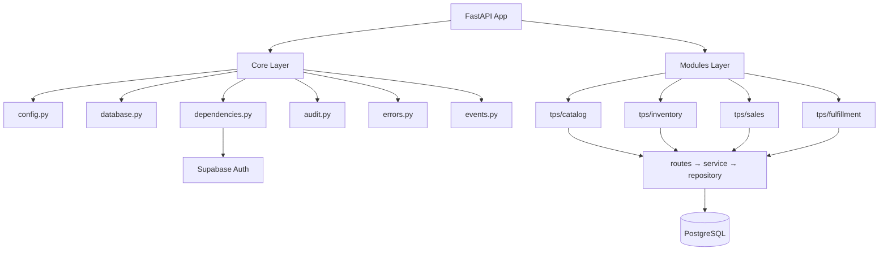
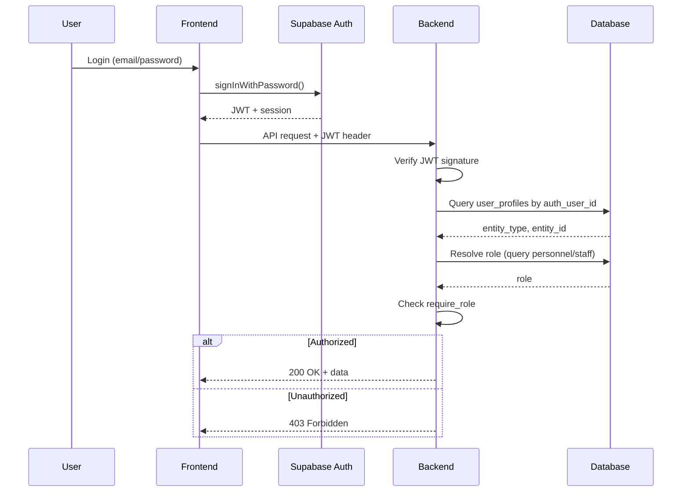
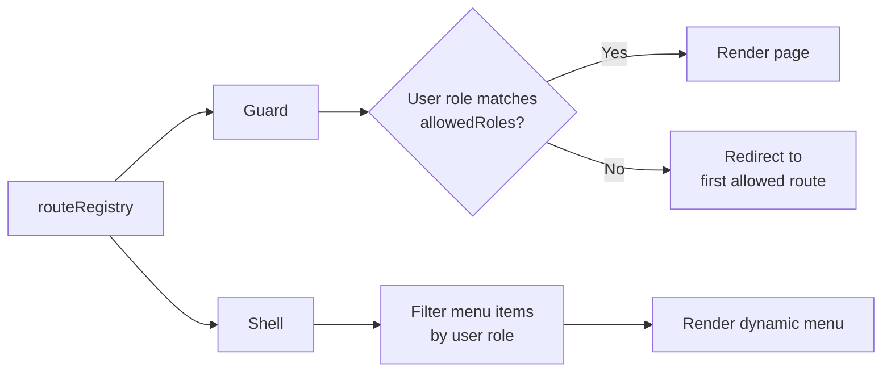
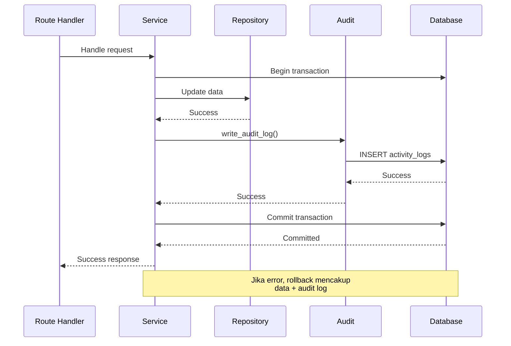

# Design Document: Platform Foundation

## Overview

**Platform Foundation** adalah fondasi teknis sistem Dewa Jam yang menyediakan infrastruktur bersama untuk semua modul TPS, OAS, KMS, MIS, dan ISS. Spec ini membangun kerangka backend FastAPI dengan Core components (config, database session, auth/RBAC, audit log, error handling, event bus), kerangka frontend React dengan route registry dan role-based routing, serta integrasi autentikasi Supabase Auth dengan mapping ke data personnel/customer yang sudah ada.

**Tujuan utama:**
- Menyediakan scaffold aplikasi backend dan frontend yang siap pakai
- Mengintegrasikan Supabase Auth dengan skema database existing tanpa mengubah data
- Membangun mekanisme RBAC terpusat berbasis database (bukan JWT claims)
- Menyediakan audit log, error handling, dan event bus sebagai layanan Core
- Membuat baseline Alembic untuk tracking perubahan skema ke depan

**Workflow:** Requirements-first (requirements → design → tasks)

---

## Architecture

### Overview

Platform Foundation mengadopsi arsitektur modular monolith dengan:
- **Backend:** FastAPI dengan Core layer (infrastruktur bersama) dan Modules layer (domain logic)
- **Frontend:** React SPA dengan route registry untuk role-based routing
- **Database:** PostgreSQL di Supabase dengan skema existing yang dijadikan baseline
- **Auth:** Supabase Auth dengan JWT verification di backend dan role resolution dari database

### Backend Structure

```
backend/
├── app/
│   ├── main.py                    # create_app(), include routers
│   ├── core/                      # Core services (no imports from modules/)
│   │   ├── __init__.py            # Export public APIs
│   │   ├── config.py              # Settings (pydantic-settings)
│   │   ├── database.py            # Engine, SessionLocal, get_db dependency
│   │   ├── dependencies.py        # get_current_user, require_role
│   │   ├── audit.py               # write_audit_log function
│   │   ├── errors.py              # Exception classes, error codes, handlers
│   │   └── events.py              # Event Bus (publish, subscribe)
│   └── modules/
│       └── tps/                   # TPS modules (scaffolded, empty for now)
│           ├── catalog/
│           │   ├── routes.py      # APIRouter
│           │   ├── service.py     # Business logic
│           │   ├── repository.py  # Database access
│           │   ├── models.py      # SQLAlchemy models
│           │   └── schemas.py     # Pydantic schemas
│           ├── inventory/
│           ├── sales/
│           └── fulfillment/
├── migrations/                    # Alembic migrations
│   ├── env.py
│   └── versions/
│       └── 001_baseline.py        # Baseline (empty upgrade/downgrade)
└── tests/
    ├── test_health.py             # Test /api/v1/health
    └── core/
        ├── test_audit.py
        ├── test_events.py
        └── test_dependencies.py
```

### Frontend Structure

```
frontend/
├── src/
│   ├── main.tsx                   # Entry point
│   ├── app/                       # Application shell
│   │   ├── App.tsx                # Root component
│   │   ├── Shell.tsx              # Layout dengan dynamic menu
│   │   ├── Guard.tsx              # Route guard
│   │   ├── registry.ts            # Route registry (single source of truth)
│   │   └── routes.tsx             # React Router setup
│   ├── shared/                    # Shared utilities
│   │   ├── api-client.ts          # Axios/fetch wrapper dengan JWT
│   │   ├── auth.ts                # Supabase Auth client
│   │   └── components/
│   │       └── ui/                # shadcn/kokonut ui components
│   └── modules/
│       └── tps/                   # TPS modules (placeholder pages)
│           ├── shop/
│           │   └── ShopPage.tsx
│           ├── inplace/
│           │   └── InplacePage.tsx
│           ├── pos/
│           │   └── PosPage.tsx
│           ├── warehouse/
│           │   └── WarehousePage.tsx
│           └── management/
│               └── ManagementPage.tsx
└── tests/
    └── app/
        └── Shell.test.tsx
```

### Database Schema Audit

#### Existing Tables and Relations

Database `toko_jam` di Supabase sudah memiliki skema yang mencakup:

#### **A. Tabel Pengguna dan Personel**

| Tabel | Primary Key | Relasi Utama | Keterangan |
|-------|-------------|--------------|------------|
| `personnel` | `personnel_id` | Referenced by admins, managers, staff | Entitas induk untuk semua personnel internal |
| `admins` | `admin_id` | FK: `personnel_id` | Admin sistem dengan `username` dan `password_hash` |
| `managers` | `manager_id` | FK: `personnel_id` | Manager toko dengan `username` dan `password_hash` |
| `staff` | `staff_id` | FK: `personnel_id`, `manager_id` (optional) | Staf dengan role: `staf_gudang` atau `staf_operasional` |
| `customers` | `customer_id` | Referenced by transactions | Pembeli dengan `nama` dan `no_hp` |

**Catatan penting:**
- `personnel.personnel_type` menyimpan tipe: `'admin'`, `'staff'`, atau `'manager'`
- `staff.role` menyimpan role spesifik: `'staf_gudang'` atau `'staf_operasional'`
- Autentikasi saat ini menggunakan `password_hash` di tabel `admins`, `managers`, dan `staff`
- **Tidak ada customer auth** — customer belum memiliki mekanisme login

#### **B. Tabel Produk dan Transaksi (TPS Core)**

| Tabel | Primary Key | Relasi Utama | Keterangan |
|-------|-------------|--------------|------------|
| `products` | `product_id` | Referenced by transaction_items | Katalog produk dengan `stok` INTEGER |
| `transactions` | `transaction_id` | FK: `customer_id`, `personnel_id` (optional) | Transaksi penjualan dengan `status`: `'selesai'` atau `'dibatalkan'` |
| `transaction_items` | `item_id` | FK: `transaction_id`, `product_id` | Line item transaksi dengan snapshot harga |

**Catatan penting:**
- `products.stok` adalah INTEGER — tidak support tracking per unit/serial number
- `products.kategori` dibatasi ke 5 jenis jam: Jam Tangan, Jam Dinding, Jam Meja, Jam Alarm, Aksesoris
- `transactions.personnel_id` NULL-able — bisa diisi untuk transaksi POS, NULL untuk marketplace/inplace
- **Tidak ada pembeda channel** (POS vs Marketplace vs Inplace) di `transactions`

#### **C. Tabel Office Automation System (OAS)**

| Tabel | Primary Key | Relasi Utama | Keterangan |
|-------|-------------|--------------|------------|
| `documents` | `document_id` | FK: `created_by` (personnel), `transaction_id` (optional) | Dokumen dengan status: draft, final, arsip |
| `messages` | `message_id` | FK: `sender_id`, `receiver_id` (personnel) | Pesan internal antar personnel |
| `notifications` | `notification_id` | FK: `target_personnel_id` | Notifikasi sistem (5 tipe) |
| `shifts` | `shift_id` | FK: `personnel_id`, `created_by` | Jadwal shift dengan status kehadiran |
| `correspondence` | `correspondence_id` | FK: `created_by` | Surat masuk/keluar dengan nomor agenda |
| `correspondence_dispositions` | `disposition_id` | FK: `correspondence_id`, `disposisi_ke` | Disposisi surat |

#### **D. Tabel Workflow dan Audit**

| Tabel | Primary Key | Relasi Utama | Keterangan |
|-------|-------------|--------------|------------|
| `activity_logs` | `log_id` | FK: `personnel_id` | Audit log dengan action: create, update, delete |
| `workflow_requests` | `request_id` | FK: `requested_by` | Request workflow dengan status: pending, approved, rejected |
| `workflow_approvals` | `approval_id` | FK: `request_id`, `approver_id` | Approval untuk workflow request |

**Catatan penting:**
- `activity_logs` sudah ada tapi hanya mencatat `personnel_id` — tidak cover customer actions
- `activity_logs.detail` menggunakan JSONB untuk fleksibilitas

#### **E. Tabel Knowledge Management System (KMS)**

| Tabel | Primary Key | Relasi Utama | Keterangan |
|-------|-------------|--------------|------------|
| `knowledge_categories` | `category_id` | Referenced by policies, FAQs, videos, etc. | Kategori konten KMS |
| `knowledge_policies` | `policy_id` | FK: `category_id`, `created_by` | Kebijakan/SOP dengan versioning |
| `knowledge_faqs` | `faq_id` | FK: `category_id`, `created_by` | FAQ dengan versioning |
| `knowledge_videos` | `video_id` | FK: `category_id`, `created_by` | Video panduan |
| `knowledge_case_studies` | `case_study_id` | FK: `category_id`, `created_by` | Studi kasus |
| `knowledge_articles` | `article_id` | FK: `category_id`, `created_by` | Artikel |
| `knowledge_attachments` | `attachment_id` | Polymorphic: `source_table`, `source_id` | Attachment untuk konten KMS |
| `knowledge_bookmarks` | `bookmark_id` | FK: `personnel_id`, polymorphic | Bookmark user |
| `knowledge_versions` | `version_id` | Polymorphic: `source_table`, `source_id` | History versioning konten |

---

### 2. Pemetaan Tabel ke Domain TPS

Berdasarkan `structure.md`, domain TPS yang direncanakan:

| Domain | Tabel yang Relevan | Status |
|--------|-------------------|--------|
| **catalog** | `products` | ✅ Ada |
| **inventory** | `products` (kolom `stok`) | ⚠️ Parsial — hanya stok agregat per SKU |
| **sales** | `transactions`, `transaction_items`, `customers` | ✅ Ada |
| **fulfillment** | - | ❌ Belum ada tabel untuk pickup/delivery tracking |

**Kesimpulan:**
- **Catalog domain** dapat langsung menggunakan `products`
- **Inventory domain** akan butuh enhancement — saat ini hanya INTEGER stok, tidak ada:
  - Serial number tracking
  - Inventory movements (incoming/outgoing)
  - Stock adjustments history
- **Sales domain** sudah cukup untuk mencatat transaksi, tapi kurang:
  - Channel identifier (POS vs Marketplace vs Inplace)
  - Payment tracking (metode pembayaran, status pembayaran terpisah)
  - Order states (pending, paid, processing, completed, cancelled)
- **Fulfillment domain** tidak ada sama sekali — perlu tabel untuk:
  - Pickup orders dengan status (ready, picked_up)
  - Delivery orders dengan tracking (pending, shipped, delivered)

---

### 3. Gap Analysis: Platform Foundation

#### **Gap 1: Tabel `user_profiles` (KRITIS — harus dibuat)**

**Masalah:**
- Supabase Auth menerbitkan JWT dengan `sub` claim (UUID user)
- Database existing menyimpan auth di `admins.username`/`password_hash`, `managers.username`/`password_hash`, `staff.username`/`password_hash`
- Tidak ada mapping antara UUID Supabase Auth (`auth.users.id`) dengan `personnel_id` atau `customer_id`

**Solusi:**
Buat tabel baru `user_profiles`:
```sql
CREATE TABLE toko_jam.user_profiles (
  auth_user_id UUID PRIMARY KEY,  -- FK ke auth.users(id) di Supabase Auth schema
  entity_type VARCHAR NOT NULL CHECK (entity_type IN ('personnel', 'customer')),
  entity_id UUID NOT NULL,  -- FK ke personnel_id atau customer_id
  created_at TIMESTAMPTZ NOT NULL DEFAULT NOW(),
  updated_at TIMESTAMPTZ NOT NULL DEFAULT NOW(),
  UNIQUE(entity_type, entity_id)  -- Satu personnel/customer hanya boleh punya satu auth user
);
```

**Strategi Migrasi:**
- Tabel ini dibuat via Alembic migration (bukan baseline)
- Data existing (`admins`, `managers`, `staff` dengan `password_hash`) **tidak otomatis** migrasi
- Migrasi user manual atau via script terpisah (di luar scope spec ini)
- Untuk development: seed `user_profiles` secara manual atau via fixture

#### **Gap 2: Role Resolution (DESAIN, bukan gap data)**

**Masalah:**
Role tersebar di beberapa tempat:
- `personnel.personnel_type`: `'admin'`, `'staff'`, `'manager'`
- `staff.role`: `'staf_gudang'`, `'staf_operasional'`
- Customer: tidak ada field role eksplisit

**Mapping yang dibutuhkan (requirements 5 role):**
| Role di Sistem | Sumber Data |
|----------------|-------------|
| `admin` | `personnel.personnel_type = 'admin'` |
| `manager` | `personnel.personnel_type = 'manager'` |
| `kasir` | `personnel.personnel_type = 'staff'` AND `staff.role = 'staf_operasional'` |
| `gudang` | `personnel.personnel_type = 'staff'` AND `staff.role = 'staf_gudang'` |
| `customer` | `user_profiles.entity_type = 'customer'` (implisit) |

**Solusi Desain:**
Buat fungsi `resolve_role(auth_user_id: UUID) -> str` di Core yang:
1. Cari `user_profiles` by `auth_user_id`
2. Jika `entity_type = 'customer'` → return `'customer'`
3. Jika `entity_type = 'personnel'` → join ke `personnel` dan `staff` (jika ada), lakukan mapping di atas
4. Raise HTTP 403 jika tidak ditemukan

#### **Gap 3: Audit Log Coverage**

**Masalah:**
- `activity_logs` hanya mencatat `personnel_id`
- Customer actions (order, payment) tidak ter-audit

**Keputusan:**
- **Untuk spec ini (platform-foundation):** Tetap gunakan `activity_logs` dengan `personnel_id` NOT NULL
- **Untuk spec TPS sales nanti:** Pertimbangkan perluasan audit (buat tabel baru `audit_events` atau ubah `activity_logs.personnel_id` jadi nullable dan tambah `customer_id`)
- Ini **keputusan yang masih terbuka** (lihat section Decisions)

#### **Gap 4: Channel Penjualan**

**Masalah:**
`transactions` tidak punya field untuk membedakan channel (POS vs Marketplace vs Inplace)

**Keputusan:**
- Bukan bagian dari spec `platform-foundation` (ini infrastruktur)
- Akan ditangani di spec TPS sales dengan menambah kolom `channel` via Alembic migration
- Baseline platform-foundation tidak menyentuh ini

---

### 4. Strategi Baseline Alembic

**Tujuan:** Membuat Alembic "mengenal" skema existing tanpa run DDL apapun.

**Strategi:**
1. **Buat baseline migration** dengan revision ID pertama (misal `001_baseline`)
2. **Fungsi `upgrade()` dan `downgrade()` kosong:**
   ```python
   def upgrade() -> None:
       pass  # Skema sudah ada di Supabase, tidak perlu DDL
   
   def downgrade() -> None:
       pass  # Tidak dapat downgrade baseline
   ```
3. **Stamp database** dengan revision ini:
   ```bash
   alembic stamp head
   ```
4. **Migration berikutnya** (misal `002_add_user_profiles`) akan menambah tabel `user_profiles` dan DDL lain

**Trade-off:**
- ✅ Tidak merusak data existing
- ✅ Alembic history dimulai dari state existing
- ❌ Tidak ada rollback ke state sebelum baseline (tapi tidak ada state sebelumnya)

---

## Components and Interfaces

### Backend Core Components

#### config.py

##### **config.py**
```python
from pydantic_settings import BaseSettings

class Settings(BaseSettings):
    DATABASE_URL: str
    SUPABASE_URL: str
    SUPABASE_JWT_SECRET: str
    SUPABASE_SERVICE_ROLE_KEY: str
    ALLOWED_ORIGINS: str = "http://localhost:5173"
    ENVIRONMENT: str = "development"
    
    class Config:
        env_file = ".env"

settings = Settings()
```

**Validasi Startup:**
- Jika `DATABASE_URL`, `SUPABASE_URL`, atau `SUPABASE_JWT_SECRET` tidak ada → `SystemExit` dengan pesan error

#### database.py
```python
from sqlalchemy import create_engine
from sqlalchemy.orm import sessionmaker, Session
from .config import settings

engine = create_engine(settings.DATABASE_URL, pool_pre_ping=True)
SessionLocal = sessionmaker(autocommit=False, autoflush=False, bind=engine)

def get_db() -> Session:
    """Dependency untuk mendapatkan database session per-request."""
    db = SessionLocal()
    try:
        yield db
    finally:
        db.close()
```

**Karakteristik:**
- SQLAlchemy 2.x sync (bukan async)
- `pool_pre_ping=True` untuk handle connection drops
- Session di-close otomatis via `finally`

#### dependencies.py
```python
from fastapi import Depends, HTTPException, Header
from sqlalchemy.orm import Session
from typing import Annotated
import jwt
from .database import get_db
from .config import settings
from .errors import ERR_UNAUTHORIZED, ERR_FORBIDDEN

async def get_current_user(
    authorization: Annotated[str | None, Header()] = None,
    db: Session = Depends(get_db)
) -> dict:
    """
    Verifikasi JWT dari header Authorization: Bearer <token>.
    Return dict dengan keys: auth_user_id, entity_type, entity_id, role.
    Raise HTTP 401 jika token invalid/expired.
    Raise HTTP 403 jika user tidak terdaftar di user_profiles.
    """
    if not authorization or not authorization.startswith("Bearer "):
        raise HTTPException(status_code=401, detail={"error": {"code": ERR_UNAUTHORIZED, "message": "Token tidak ditemukan", "detail": None}})
    
    token = authorization.split(" ", 1)[1]
    
    try:
        payload = jwt.decode(token, settings.SUPABASE_JWT_SECRET, algorithms=["HS256"])
        auth_user_id = payload.get("sub")
    except jwt.ExpiredSignatureError:
        raise HTTPException(status_code=401, detail={"error": {"code": ERR_UNAUTHORIZED, "message": "Token kedaluwarsa", "detail": None}})
    except jwt.InvalidTokenError:
        raise HTTPException(status_code=401, detail={"error": {"code": ERR_UNAUTHORIZED, "message": "Token tidak valid", "detail": None}})
    
    # Cari user_profiles
    profile = db.query(UserProfile).filter(UserProfile.auth_user_id == auth_user_id).first()
    if not profile:
        raise HTTPException(status_code=403, detail={"error": {"code": ERR_FORBIDDEN, "message": "Pengguna tidak terdaftar di sistem", "detail": None}})
    
    # Resolve role
    role = resolve_role(db, profile)
    
    return {
        "auth_user_id": auth_user_id,
        "entity_type": profile.entity_type,
        "entity_id": profile.entity_id,
        "role": role
    }

def require_role(*allowed_roles: str):
    """
    Dependency factory untuk RBAC.
    Usage: Depends(require_role("admin", "manager"))
    """
    def _require_role(current_user: dict = Depends(get_current_user)) -> dict:
        if current_user["role"] not in allowed_roles:
            raise HTTPException(status_code=403, detail={"error": {"code": ERR_FORBIDDEN, "message": "Akses ditolak", "detail": None}})
        return current_user
    return _require_role

def resolve_role(db: Session, profile: UserProfile) -> str:
    """Resolve role dari database berdasarkan entity_type dan entity_id."""
    if profile.entity_type == "customer":
        return "customer"
    
    # entity_type = 'personnel'
    personnel = db.query(Personnel).filter(Personnel.personnel_id == profile.entity_id).first()
    if not personnel:
        raise HTTPException(status_code=403, detail={"error": {"code": ERR_FORBIDDEN, "message": "Data personnel tidak ditemukan", "detail": None}})
    
    if personnel.personnel_type == "admin":
        return "admin"
    elif personnel.personnel_type == "manager":
        return "manager"
    elif personnel.personnel_type == "staff":
        # Cari staff.role
        staff = db.query(Staff).filter(Staff.personnel_id == profile.entity_id).first()
        if staff:
            if staff.role == "staf_operasional":
                return "kasir"
            elif staff.role == "staf_gudang":
                return "gudang"
    
    # Fallback jika tidak match apapun
    raise HTTPException(status_code=403, detail={"error": {"code": ERR_FORBIDDEN, "message": "Role tidak valid", "detail": None}})
```

**Keputusan:**
- JWT diverifikasi setiap request (no caching)
- Role di-resolve dari database setiap request (trade-off latency vs consistency)
- JWT `sub` claim adalah satu-satunya data dari token yang dipercaya — role tidak dibaca dari JWT

#### audit.py
```python
from sqlalchemy.orm import Session
from typing import Literal
import uuid

def write_audit_log(
    session: Session,
    personnel_id: uuid.UUID,
    action: Literal["create", "update", "delete"],
    table_name: str,
    record_id: uuid.UUID | None = None,
    detail: dict | None = None
) -> None:
    """
    Menulis audit log ke tabel toko_jam.activity_logs.
    
    Args:
        session: SQLAlchemy session (harus dalam transaksi yang sama dengan perubahan data)
        personnel_id: UUID personnel yang melakukan aksi
        action: Salah satu dari "create", "update", "delete"
        table_name: Nama tabel yang diubah
        record_id: UUID record yang diubah (optional)
        detail: Dict tambahan untuk disimpan sebagai JSONB (optional)
    
    Raises:
        ValueError: Jika action tidak valid
        IntegrityError: Jika personnel_id tidak ada di tabel personnel
    """
    if action not in ["create", "update", "delete"]:
        raise ValueError(f"Invalid action: {action}. Must be one of: create, update, delete")
    
    log = ActivityLog(
        personnel_id=personnel_id,
        action=action,
        table_name=table_name,
        record_id=record_id,
        detail=detail
    )
    session.add(log)
    # Tidak commit — biarkan caller yang handle transaksi
```

**Karakteristik:**
- Tidak auto-commit — caller bertanggung jawab commit/rollback
- Validasi `action` sebelum INSERT
- FK constraint akan raise `IntegrityError` jika `personnel_id` invalid (caught by global exception handler)

#### errors.py
```python
from fastapi import Request, HTTPException
from fastapi.responses import JSONResponse
from fastapi.exceptions import RequestValidationError

# Error codes constants
ERR_UNAUTHORIZED = "unauthorized"
ERR_FORBIDDEN = "forbidden"
ERR_NOT_FOUND = "not_found"
ERR_VALIDATION = "validation_error"
ERR_INTERNAL = "internal_error"
ERR_SERVICE_UNAVAILABLE = "service_unavailable"

def error_response(code: str, message: str, detail=None) -> dict:
    """Helper untuk membuat format error response standar."""
    return {
        "error": {
            "code": code,
            "message": message,
            "detail": detail
        }
    }

async def global_exception_handler(request: Request, exc: Exception):
    """Global handler untuk exception yang tidak tertangani."""
    # Jangan expose stack trace atau detail internal
    return JSONResponse(
        status_code=500,
        content=error_response(ERR_INTERNAL, "Terjadi kesalahan internal server")
    )

async def http_exception_handler(request: Request, exc: HTTPException):
    """Handler untuk HTTPException FastAPI."""
    # Pastikan format sesuai standar
    if isinstance(exc.detail, dict) and "error" in exc.detail:
        return JSONResponse(status_code=exc.status_code, content=exc.detail)
    else:
        return JSONResponse(
            status_code=exc.status_code,
            content=error_response(ERR_INTERNAL, str(exc.detail))
        )

async def validation_exception_handler(request: Request, exc: RequestValidationError):
    """Handler untuk validation error Pydantic."""
    errors = []
    for error in exc.errors():
        field_path = ".".join(str(loc) for loc in error["loc"])
        errors.append({
            "field": field_path,
            "reason": error["msg"]
        })
    
    return JSONResponse(
        status_code=422,
        content=error_response(ERR_VALIDATION, "Validasi gagal", errors)
    )
```

**Karakteristik:**
- Format standar: `{"error": {"code": "...", "message": "...", "detail": ...}}`
- Detail bisa NULL tapi field-nya tetap ada
- Global handler tidak ekspos informasi internal (no stack trace, no variable names)

#### events.py
```python
from typing import Callable
import logging

logger = logging.getLogger(__name__)

_subscribers: dict[str, list[Callable[[dict], None]]] = {}

def subscribe(event_name: str, handler: Callable[[dict], None]) -> None:
    """
    Daftarkan handler untuk event tertentu.
    
    Args:
        event_name: Nama event (max 255 karakter, non-empty)
        handler: Fungsi yang menerima dict payload
    """
    if not event_name or len(event_name) > 255:
        raise ValueError("event_name harus non-empty dan max 255 karakter")
    
    if event_name not in _subscribers:
        _subscribers[event_name] = []
    _subscribers[event_name].append(handler)

def publish(event_name: str, payload: dict) -> None:
    """
    Publikasikan event ke semua subscriber.
    
    Args:
        event_name: Nama event
        payload: Dict data event
    
    Note:
        Jika handler melempar exception, exception di-log tapi tidak menghentikan
        eksekusi handler lain atau proses utama.
    """
    if not event_name or len(event_name) > 255:
        raise ValueError("event_name harus non-empty dan max 255 karakter")
    
    handlers = _subscribers.get(event_name, [])
    for handler in handlers:
        try:
            handler(payload)
        except Exception as e:
            logger.warning(f"Handler untuk event '{event_name}' gagal: {e}", exc_info=True)
```

**Karakteristik:**
- In-process synchronous (bukan message broker)
- Isolasi error: satu handler gagal tidak mempengaruhi handler lain
- Tidak ada retry atau dead letter queue

#### main.py
```python
from fastapi import FastAPI
from fastapi.middleware.cors import CORSMiddleware
from fastapi.exceptions import RequestValidationError
from starlette.exceptions import HTTPException as StarletteHTTPException
from datetime import datetime, timezone
from .core import settings, events
from .core.errors import (
    global_exception_handler,
    http_exception_handler,
    validation_exception_handler
)

def create_app() -> FastAPI:
    """Factory untuk membuat instance FastAPI."""
    app = FastAPI(
        title="Dewa Jam API",
        version="1.0.0",
        docs_url="/docs",
        redoc_url="/redoc"
    )
    
    # CORS
    origins = [origin.strip() for origin in settings.ALLOWED_ORIGINS.split(",")]
    app.add_middleware(
        CORSMiddleware,
        allow_origins=origins,
        allow_credentials=True,
        allow_methods=["GET", "POST", "PUT", "PATCH", "DELETE"],
        allow_headers=["*"],
    )
    
    # Exception handlers
    app.add_exception_handler(Exception, global_exception_handler)
    app.add_exception_handler(StarletteHTTPException, http_exception_handler)
    app.add_exception_handler(RequestValidationError, validation_exception_handler)
    
    # Health check endpoint
    @app.get("/api/v1/health")
    async def health_check():
        return {"status": "ok"}
    
    # Include routers (akan ditambah saat module TPS dibuat)
    # from .modules.tps.catalog.routes import router as catalog_router
    # app.include_router(catalog_router, prefix="/api/v1/tps/catalog", tags=["Catalog"])
    
    # Publish app.started event
    events.publish("app.started", {"timestamp": datetime.now(timezone.utc).isoformat()})
    
    return app

app = create_app()
```

---

### 2. Frontend Architecture

```
frontend/
├── src/
│   ├── main.tsx                   # Entry point
│   ├── app/                       # Application shell
│   │   ├── App.tsx                # Root component
│   │   ├── Shell.tsx              # Layout dengan dynamic menu
│   │   ├── Guard.tsx              # Route guard
│   │   ├── registry.ts            # Route registry (single source of truth)
│   │   └── routes.tsx             # React Router setup
│   ├── shared/                    # Shared utilities
│   │   ├── api-client.ts          # Axios/fetch wrapper dengan JWT
│   │   ├── auth.ts                # Supabase Auth client
│   │   └── components/
│   │       └── ui/                # shadcn/kokonut ui components
│   └── modules/
│       └── tps/                   # TPS modules (placeholder pages)
│           ├── shop/
│           │   └── ShopPage.tsx
│           ├── inplace/
│           │   └── InplacePage.tsx
│           ├── pos/
│           │   └── PosPage.tsx
│           ├── warehouse/
│           │   └── WarehousePage.tsx
│           └── management/
│               └── ManagementPage.tsx
└── tests/
    └── app/
        └── Shell.test.tsx
```

### Frontend Components

**Frontend Structure:**
```
frontend/
├── src/
│   ├── main.tsx                   # Entry point
│   ├── app/                       # Application shell
│   │   ├── App.tsx                # Root component
│   │   ├── Shell.tsx              # Layout dengan dynamic menu
│   │   ├── Guard.tsx              # Route guard
│   │   ├── registry.ts            # Route registry (single source of truth)
│   │   └── routes.tsx             # React Router setup
│   ├── shared/                    # Shared utilities
│   │   ├── api-client.ts          # Axios/fetch wrapper dengan JWT
│   │   ├── auth.ts                # Supabase Auth client
│   │   └── components/
│   │       └── ui/                # shadcn/kokonut ui components
│   └── modules/
│       └── tps/                   # TPS modules (placeholder pages)
│           ├── shop/
│           │   └── ShopPage.tsx
│           ├── inplace/
│           │   └── InplacePage.tsx
│           ├── pos/
│           │   └── PosPage.tsx
│           ├── warehouse/
│           │   └── WarehousePage.tsx
│           └── management/
│               └── ManagementPage.tsx
└── tests/
    └── app/
        └── Shell.test.tsx
```

#### registry.ts
```typescript
export interface RouteConfig {
  path: string;
  label: string;
  allowedRoles: string[];
  component: React.ComponentType;
}

export const routeRegistry: RouteConfig[] = [
  {
    path: "/shop",
    label: "Toko Online",
    allowedRoles: ["customer", "admin"],
    component: () => import("../modules/tps/shop/ShopPage")
  },
  {
    path: "/inplace",
    label: "Inplace Store",
    allowedRoles: ["customer", "admin"],
    component: () => import("../modules/tps/inplace/InplacePage")
  },
  {
    path: "/pos",
    label: "Kasir",
    allowedRoles: ["kasir", "manager", "admin"],
    component: () => import("../modules/tps/pos/PosPage")
  },
  {
    path: "/warehouse",
    label: "Gudang",
    allowedRoles: ["gudang", "manager", "admin"],
    component: () => import("../modules/tps/warehouse/WarehousePage")
  },
  {
    path: "/management",
    label: "Manajemen",
    allowedRoles: ["manager", "admin"],
    component: () => import("../modules/tps/management/ManagementPage")
  }
];
```

**Karakteristik:**
- Single source of truth untuk routing dan otorisasi
- Menambah area baru = tambah entri di array ini saja
- Guard dan Shell membaca registry secara dinamis

#### Guard.tsx
```typescript
import { useEffect, useState } from "react";
import { useNavigate, useLocation } from "react-router-dom";
import { supabase } from "../shared/auth";
import { routeRegistry } from "./registry";

export function Guard({ children }: { children: React.ReactNode }) {
  const [isAuthorized, setIsAuthorized] = useState<boolean | null>(null);
  const [userRole, setUserRole] = useState<string | null>(null);
  const navigate = useNavigate();
  const location = useLocation();

  useEffect(() => {
    checkAuth();
  }, [location.pathname]);

  const checkAuth = async () => {
    const { data: { session } } = await supabase.auth.getSession();
    
    if (!session) {
      navigate("/login");
      return;
    }

    // Fetch user role dari backend
    const role = await fetchUserRole(session.access_token);
    setUserRole(role);

    // Cek apakah user boleh akses route ini
    const currentRoute = routeRegistry.find(r => location.pathname.startsWith(r.path));
    
    if (!currentRoute) {
      // Route tidak terdaftar, ijinkan (untuk login, 404, etc)
      setIsAuthorized(true);
      return;
    }

    if (!currentRoute.allowedRoles.includes(role)) {
      // Cari route pertama yang sesuai dengan role user
      const allowedRoute = routeRegistry.find(r => r.allowedRoles.includes(role));
      if (allowedRoute) {
        navigate(allowedRoute.path);
      } else {
        navigate("/login");
      }
      return;
    }

    setIsAuthorized(true);
  };

  if (isAuthorized === null) {
    return <div>Loading...</div>;
  }

  return <>{children}</>;
}
```

**Keputusan:**
- Role di-fetch dari backend setiap kali route berubah (bisa di-cache nanti untuk optimasi)
- Redirect ke route pertama yang sesuai role jika akses ditolak

#### Shell.tsx
```typescript
import { useEffect, useState } from "react";
import { Link } from "react-router-dom";
import { supabase } from "../shared/auth";
import { routeRegistry } from "./registry";

export function Shell({ children }: { children: React.ReactNode }) {
  const [userRole, setUserRole] = useState<string | null>(null);
  const [menuItems, setMenuItems] = useState<typeof routeRegistry>([]);

  useEffect(() => {
    loadMenu();
  }, []);

  const loadMenu = async () => {
    const { data: { session } } = await supabase.auth.getSession();
    if (!session) return;

    const role = await fetchUserRole(session.access_token);
    setUserRole(role);

    // Filter menu berdasarkan role
    const allowed = routeRegistry.filter(r => r.allowedRoles.includes(role));
    setMenuItems(allowed);
  };

  return (
    <div className="shell">
      <nav>
        <ul>
          {menuItems.map(item => (
            <li key={item.path}>
              <Link to={item.path}>{item.label}</Link>
            </li>
          ))}
        </ul>
      </nav>
      <main>{children}</main>
    </div>
  );
}
```

**Karakteristik:**
- Menu dibangun secara dinamis dari `routeRegistry`
- Tidak ada hardcoded role-to-URL mapping

#### api-client.ts
```typescript
import axios from "axios";
import { supabase } from "./auth";

const apiClient = axios.create({
  baseURL: import.meta.env.VITE_API_BASE_URL || "http://localhost:8000",
});

// Intercept semua request untuk menambahkan JWT
apiClient.interceptors.request.use(async (config) => {
  const { data: { session } } = await supabase.auth.getSession();
  
  if (!session) {
    throw new Error("No active session");
  }

  config.headers.Authorization = `Bearer ${session.access_token}`;
  return config;
});

// Intercept response untuk handle 401 (redirect ke login)
apiClient.interceptors.response.use(
  (response) => response,
  (error) => {
    if (error.response?.status === 401) {
      supabase.auth.signOut();
      window.location.href = "/login";
    }
    return Promise.reject(error);
  }
);

export default apiClient;
```

**Keputusan:**
- JWT disimpan di memori (Supabase client state), bukan localStorage
- Auto-logout jika backend return 401

#### auth.ts
```typescript
import { createClient } from "@supabase/supabase-js";

const supabaseUrl = import.meta.env.VITE_SUPABASE_URL;
const supabaseAnonKey = import.meta.env.VITE_SUPABASE_ANON_KEY;

if (!supabaseUrl || !supabaseAnonKey) {
  throw new Error("Supabase URL dan Anon Key harus diset di environment variables");
}

export const supabase = createClient(supabaseUrl, supabaseAnonKey);
```

**Validasi:**
- Throw error saat startup jika env vars tidak ada

---

## Data Models

### user_profiles Table

**SQLAlchemy Model:**

```python
from sqlalchemy import Column, String, DateTime, CheckConstraint, UniqueConstraint
from sqlalchemy.dialects.postgresql import UUID
from sqlalchemy.sql import func
import uuid

class UserProfile(Base):
    __tablename__ = "user_profiles"
    __table_args__ = (
        CheckConstraint("entity_type IN ('personnel', 'customer')", name="check_entity_type"),
        UniqueConstraint("entity_type", "entity_id", name="uq_entity"),
        {"schema": "toko_jam"}
    )
    
    auth_user_id = Column(UUID(as_uuid=True), primary_key=True, default=uuid.uuid4)
    entity_type = Column(String, nullable=False)
    entity_id = Column(UUID(as_uuid=True), nullable=False)
    created_at = Column(DateTime(timezone=True), server_default=func.now(), nullable=False)
    updated_at = Column(DateTime(timezone=True), server_default=func.now(), onupdate=func.now(), nullable=False)
```

**Alembic Migration (002_add_user_profiles.py):**

```python
"""Add user_profiles table

Revision ID: 002
Revises: 001
"""
from alembic import op
import sqlalchemy as sa
from sqlalchemy.dialects.postgresql import UUID

def upgrade() -> None:
    op.create_table(
        "user_profiles",
        sa.Column("auth_user_id", UUID(as_uuid=True), primary_key=True),
        sa.Column("entity_type", sa.String(), nullable=False),
        sa.Column("entity_id", UUID(as_uuid=True), nullable=False),
        sa.Column("created_at", sa.DateTime(timezone=True), server_default=sa.func.now(), nullable=False),
        sa.Column("updated_at", sa.DateTime(timezone=True), server_default=sa.func.now(), nullable=False),
        sa.CheckConstraint("entity_type IN ('personnel', 'customer')", name="check_entity_type"),
        sa.UniqueConstraint("entity_type", "entity_id", name="uq_entity"),
        schema="toko_jam"
    )
    
    # Index untuk query by auth_user_id (sudah PK, auto-indexed)
    # Index untuk query by entity
    op.create_index(
        "ix_user_profiles_entity",
        "user_profiles",
        ["entity_type", "entity_id"],
        schema="toko_jam"
    )

def downgrade() -> None:
    op.drop_index("ix_user_profiles_entity", table_name="user_profiles", schema="toko_jam")
    op.drop_table("user_profiles", schema="toko_jam")
```

**Constraint dan Index:**
- PK: `auth_user_id` (UUID dari Supabase Auth)
- Unique: `(entity_type, entity_id)` — satu personnel/customer hanya bisa punya satu akun
- Check: `entity_type IN ('personnel', 'customer')`
- Index: `(entity_type, entity_id)` untuk reverse lookup

**Foreign Key:**
- `auth_user_id` secara konseptual FK ke `auth.users(id)` di Supabase (schema terpisah)
- Tidak dibuat sebagai FK constraint karena lintas schema dan Supabase Auth mengelola schema `auth`
- `entity_id` tidak dibuat FK ke `personnel`/`customers` karena polymorphic (bisa salah satu)

---

### API Endpoints

#### GET /api/v1/health

**Deskripsi:** Health check endpoint untuk memverifikasi backend berjalan.

**Request:**
- Method: `GET`
- Headers: Tidak ada (no auth required)
- Body: Tidak ada

**Response 200 OK:**
```json
{
  "status": "ok"
}
```

**Karakteristik:**
- Tidak membutuhkan autentikasi
- Tidak melakukan query database (fast check)
- Digunakan oleh monitoring/load balancer

---

**Catatan:** Tidak ada endpoint lain di spec `platform-foundation`. Endpoint untuk TPS (catalog, inventory, sales, fulfillment) akan dibuat di spec-spec TPS terpisah.

---

### Event Bus Events

#### Event: app.started

**Publisher:** `app/main.py` (fungsi `create_app`)

**Payload:**
```json
{
  "timestamp": "2024-01-15T10:30:45.123456Z"
}
```

**Subscriber:** Tidak ada (untuk testing/verification saja)

**Tujuan:** Memverifikasi Event Bus berfungsi dengan benar.

**Contoh penggunaan di testing:**
```python
def test_app_started_event_published():
    received_events = []
    
    def handler(payload):
        received_events.append(payload)
    
    events.subscribe("app.started", handler)
    app = create_app()
    
    assert len(received_events) == 1
    assert "timestamp" in received_events[0]
```

---

**Event TPS** (untuk spec berikutnya, bukan bagian platform-foundation):
- `order.created` (sales → inventory, fulfillment)
- `payment.confirmed` (sales → fulfillment)
- `stock.depleted` (inventory → notifications)
- dll.

---

## Error Handling

### Format Error Response Standar

Semua error dari backend mengikuti format:

```json
{
  "error": {
    "code": "error_code_string",
    "message": "Human-readable error message",
    "detail": null | object | array
  }
}
```

**Aturan:**
- Field `detail` harus selalu ada (bisa `null`)
- Field `detail` tidak boleh dihilangkan

### Error Codes

| Code | HTTP Status | Deskripsi |
|------|-------------|-----------|
| `unauthorized` | 401 | Token tidak ada, invalid, atau expired |
| `forbidden` | 403 | User tidak punya akses ke resource |
| `not_found` | 404 | Resource tidak ditemukan |
| `validation_error` | 422 | Request body gagal validasi Pydantic |
| `internal_error` | 500 | Server error internal (tidak expose detail) |
| `service_unavailable` | 503 | Database/service tidak dapat dijangkau |

### Contoh Error Response

**401 Unauthorized (Token expired):**
```json
{
  "error": {
    "code": "unauthorized",
    "message": "Token kedaluwarsa",
    "detail": null
  }
}
```

**403 Forbidden:**
```json
{
  "error": {
    "code": "forbidden",
    "message": "Akses ditolak",
    "detail": null
  }
}
```

**422 Validation Error:**
```json
{
  "error": {
    "code": "validation_error",
    "message": "Validasi gagal",
    "detail": [
      {
        "field": "body.harga",
        "reason": "field required"
      },
      {
        "field": "body.stok",
        "reason": "value is not a valid integer"
      }
    ]
  }
}
```

**500 Internal Server Error:**
```json
{
  "error": {
    "code": "internal_error",
    "message": "Terjadi kesalahan internal server",
    "detail": null
  }
}
```

**Catatan keamanan:**
- Error 500 tidak pernah mengekspos stack trace, nama file, nama variabel, atau pesan exception mentah
- Semua detail internal di-log ke server log, tapi tidak dikirim ke client

---

## Testing Strategy

### Backend Testing

**Framework:** pytest

**Test Coverage:**
1. **Unit Tests:**
   - `test_health.py`: Test endpoint `/api/v1/health`
   - `core/test_audit.py`: Test `write_audit_log` function
   - `core/test_events.py`: Test Event Bus `publish` dan `subscribe`
   - `core/test_dependencies.py`: Test `get_current_user` dan `require_role`
   - `core/test_errors.py`: Test error handlers dan format response

2. **Integration Tests:**
   - Test JWT verification dengan Supabase mock
   - Test database session lifecycle
   - Test audit log dalam transaksi (commit/rollback)

**Contoh Test:**
```python
# tests/test_health.py
from fastapi.testclient import TestClient
from app.main import app

client = TestClient(app)

def test_health_check():
    response = client.get("/api/v1/health")
    assert response.status_code == 200
    assert response.json() == {"status": "ok"}
```

**Test Database:**
- Gunakan SQLite in-memory atau PostgreSQL test database
- Alembic migrations di-run di test database
- Rollback setiap test untuk isolasi

---

### Frontend Testing

**Framework:** Vitest + React Testing Library

**Test Coverage:**
1. **Component Tests:**
   - `app/Shell.test.tsx`: Test Shell render dan dynamic menu
   - `app/Guard.test.tsx`: Test Guard redirect logic
   
2. **Integration Tests:**
   - Test routing berdasarkan `routeRegistry`
   - Test API client JWT injection

**Contoh Test:**
```typescript
// src/app/Shell.test.tsx
import { render, screen } from "@testing-library/react";
import { Shell } from "./Shell";
import { BrowserRouter } from "react-router-dom";

describe("Shell", () => {
  it("renders without crashing", () => {
    render(
      <BrowserRouter>
        <Shell>
          <div>Test content</div>
        </Shell>
      </BrowserRouter>
    );
    expect(screen.getByText("Test content")).toBeInTheDocument();
  });
});
```

---

### Property-Based Testing

**Platform-foundation tidak memerlukan property-based testing** karena:
- Ini adalah infrastruktur/scaffolding, bukan business logic dengan input domain kompleks
- Komponen Core (auth, audit, events) lebih cocok untuk example-based unit tests
- JWT verification mengikuti spec eksternal (Supabase)
- Route registry adalah config statis

**Property-based testing akan digunakan di spec TPS** untuk:
- Validasi business rules (harga, stok, diskon)
- Serialization/deserialization data
- State transitions (order states, payment states)

---

## Keputusan Desain dan Trade-offs

### 1. Baseline Alembic: Empty Upgrade/Downgrade

**Keputusan:** Migration pertama (`001_baseline.py`) memiliki `upgrade()` dan `downgrade()` yang hanya `pass`.

**Alasan:**
- Skema Supabase sudah ada dan berisi data
- Running DDL dari Alembic bisa merusak data atau bentrok dengan Supabase tooling
- Alembic tetap perlu tahu "state awal" untuk tracking perubahan berikutnya

**Trade-off:**
- ✅ Tidak merusak data existing
- ✅ History dimulai dari state existing yang jelas
- ❌ Tidak bisa rollback ke "state sebelum baseline" (tapi memang tidak ada state sebelumnya)
- ❌ Developer harus manual stamp database pertama kali: `alembic stamp 001`

**Alternatif yang ditolak:**
- Generate migration dari introspection database → berisiko jika ada perbedaan minor (collation, default values)
- Tidak pakai Alembic → kehilangan version control untuk skema

---

### 2. JWT Storage: Memori Sesi (Supabase Client State)

**Keputusan:** JWT disimpan di memori oleh Supabase client, tidak di localStorage.

**Alasan:**
- Keamanan: localStorage rentan XSS
- Supabase client mengelola refresh token secara otomatis
- Session hilang saat tab ditutup (user harus login ulang)

**Trade-off:**
- ✅ Lebih aman dari XSS
- ✅ Auto-refresh token
- ❌ User harus login ulang setiap buka browser (no "remember me")

**Alternatif yang ditolak:**
- localStorage → rentan XSS
- Cookie httpOnly → butuh custom auth flow (Supabase default pakai memori/localStorage)

---

### 3. Role Resolution: Query Database Setiap Request

**Keputusan:** `require_role` query database setiap request untuk mendapatkan role user.

**Alasan:**
- Consistency: role di database selalu up-to-date
- Simplicity: tidak perlu cache invalidation logic
- Security: role tidak bisa di-forge di JWT

**Trade-off:**
- ✅ Selalu consistent dengan database
- ✅ Role bisa berubah tanpa re-login
- ❌ Latency: extra query per request (~5-20ms)
- ❌ Tidak scale untuk traffic sangat tinggi (tapi ini monolith, bukan microservices)

**Alternatif yang ditolak:**
- Cache role di JWT claims → role stale sampai token expired
- Cache role di Redis → tambah complexity (cache invalidation, Redis setup)

**Optimasi masa depan:**
- Bisa tambahkan cache in-memory dengan TTL 60 detik jika latency jadi masalah

---

### 4. Event Bus: In-Process Synchronous

**Keputusan:** Event Bus adalah in-process (Python dictionary global + function calls).

**Alasan:**
- Modular monolith tidak butuh distributed messaging
- Sederhana: tidak perlu RabbitMQ/Kafka/Redis
- Cukup untuk koordinasi antar module dalam satu proses

**Trade-off:**
- ✅ Zero-dependency (no message broker)
- ✅ Sederhana: publish/subscribe langsung di Python
- ❌ Tidak persist: event hilang jika proses crash sebelum handler selesai
- ❌ Tidak scale horizontal: hanya dalam satu instance backend
- ❌ Synchronous: handler blocking bisa slow down request

**Alternatif yang ditolak:**
- RabbitMQ/Kafka → overkill untuk monolith phase 1
- Redis Pub/Sub → tambah dependency, masih butuh polling atau blocking

**Migrasi masa depan:**
- Jika scale horizontal butuh event persistence → ganti dengan Redis Streams atau message broker
- Saat itu, ganti implementasi `publish`/`subscribe` tanpa ubah caller (interface tetap sama)

---

### 5. Route Registry: Metadata-Driven Routing

**Keputusan:** Frontend routing dan otorisasi didefinisikan di satu file `registry.ts` sebagai single source of truth.

**Alasan:**
- DRY: Guard dan Shell membaca dari registry yang sama
- Extensible: tambah route baru = tambah satu entri di registry
- Maintainability: tidak ada hardcoded role-to-URL mapping tersebar di banyak file

**Trade-off:**
- ✅ Single source of truth
- ✅ Mudah tambah area baru (no code change di Guard/Shell)
- ❌ Butuh discipline: developer harus selalu update registry, tidak bisa langsung tambah Route di router saja

**Alternatif yang ditolak:**
- Hardcode role checking di setiap component → tidak scalable, error-prone
- Decorator/HOC per route → tersebar, sulit audit

---

### 6. SQLAlchemy Sync (Bukan Async)

**Keputusan:** Gunakan SQLAlchemy 2.x sync, bukan async.

**Alasan:**
- Simplicity: sync code lebih mudah debug dan dipahami
- FastAPI support keduanya (blocking I/O di-handle oleh worker threads)
- Tidak ada IO-bound operation lain yang butuh async (no websocket, no concurrent API calls)

**Trade-off:**
- ✅ Lebih sederhana
- ✅ Kompatibel dengan library existing (Alembic, testing)
- ❌ Tidak bisa pakai `asyncio` concurrency dalam satu request
- ❌ Uvicorn worker threads terbatas (tapi cukup untuk load moderate)

**Alternatif yang ditolak:**
- SQLAlchemy async → tambah complexity, tidak ada benefit signifikan untuk use case ini

---

## Keputusan yang Masih Terbuka

### 1. Payment Gateway

**Masalah:** TPS sales butuh integrasi payment gateway untuk pembayaran online (Marketplace dan Inplace).

**Opsi:**
- **Midtrans:** Populer di Indonesia, dokumentasi lengkap, support VA/QRIS/credit card
- **Xendit:** API modern, support lebih banyak metode, tapi setup lebih kompleks

**Keputusan:** Ditunda sampai spec TPS sales. Tidak mempengaruhi platform foundation.

---

### 2. Image Storage untuk Product Photos

**Masalah:** Produk butuh foto (1-5 foto per produk).

**Opsi:**
- **Supabase Storage:** Sudah pakai Supabase, terintegrasi dengan auth
- **CDN eksternal (Cloudinary, ImgIx):** Optimasi image (resize, compress) otomatis

**Keputusan:** Ditunda sampai spec TPS catalog. Tidak mempengaruhi platform foundation.

---

### 3. Migrasi User Existing ke Supabase Auth

**Masalah:** Database existing punya user di tabel `admins`, `managers`, `staff` dengan `password_hash` (bukan Supabase Auth).

**Pertanyaan:**
- Apakah user existing perlu di-migrate ke Supabase Auth?
- Jika ya, otomatis (script) atau manual?
- Bagaimana handle password (Supabase tidak bisa import hash existing)?

**Opsi:**
1. **Manual migration:** Admin buat akun Supabase untuk setiap user, user login pertama kali set password baru
2. **Script migration:** Buat user di Supabase via Admin API, kirim email reset password
3. **Dual auth sementara:** Support login via `password_hash` dan Supabase Auth, fase-out bertahap

**Keputusan:** Ditunda. Untuk development, seed `user_profiles` dengan mapping manual. Production migration diputuskan sebelum deployment.

---

### 4. Audit Log untuk Customer Actions

**Masalah:** `activity_logs` hanya mencatat `personnel_id`. Customer actions (order, payment, review) tidak ter-audit.

**Pertanyaan:**
- Apakah customer actions perlu audit log?
- Jika ya, ubah `activity_logs.personnel_id` jadi nullable + tambah `customer_id`?
- Atau buat tabel terpisah `customer_audit_logs`?

**Keputusan:** Untuk spec platform-foundation, tetap gunakan `activity_logs` as-is (hanya personnel). Pertimbangkan lagi di spec TPS sales (jika butuh audit order/payment customer).

---

### 5. Granularity Inventory Tracking

**Masalah:** `products.stok` adalah INTEGER (stok agregat per SKU). Tidak support:
- Serial number tracking (untuk jam mahal yang perlu traced per unit)
- Batch/lot tracking (untuk jam dengan tanggal produksi tertentu)
- Location tracking (jika multi-cabang nanti)

**Pertanyaan:**
- Apakah butuh tracking per unit sejak awal?
- Atau cukup INTEGER untuk fase 1, enhance nanti?

**Keputusan:** Untuk spec platform-foundation, terima `products.stok` as-is (INTEGER). Spec TPS inventory akan memutuskan apakah butuh tabel `inventory_units` atau tetap agregat.

---

## Dependencies dan Prerequisites

### Backend Dependencies (requirements.txt)

```
fastapi==0.109.0
uvicorn[standard]==0.27.0
sqlalchemy==2.0.25
alembic==1.13.1
pydantic==2.5.3
pydantic-settings==2.1.0
psycopg2-binary==2.9.9
pyjwt==2.8.0
python-dotenv==1.0.0
pytest==7.4.4
httpx==0.26.0  # untuk TestClient FastAPI
```

### Frontend Dependencies (package.json)

```json
{
  "dependencies": {
    "react": "^18.2.0",
    "react-dom": "^18.2.0",
    "react-router-dom": "^6.21.0",
    "@supabase/supabase-js": "^2.39.0",
    "axios": "^1.6.5",
    "@tanstack/react-query": "^5.17.0"
  },
  "devDependencies": {
    "typescript": "^5.3.3",
    "vite": "^5.0.11",
    "@vitejs/plugin-react": "^4.2.1",
    "vitest": "^1.2.0",
    "@testing-library/react": "^14.1.2",
    "@testing-library/jest-dom": "^6.2.0",
    "eslint": "^8.56.0",
    "prettier": "^3.1.1",
    "tailwindcss": "^3.4.1"
  }
}
```

### Infrastructure Prerequisites

1. **PostgreSQL Database di Supabase**
   - Schema `toko_jam` sudah ada dengan tabel existing
   - Supabase Auth enabled
   - Service role key tersedia

2. **Environment Variables**
   - Backend: `DATABASE_URL`, `SUPABASE_URL`, `SUPABASE_JWT_SECRET`, `SUPABASE_SERVICE_ROLE_KEY`
   - Frontend: `VITE_SUPABASE_URL`, `VITE_SUPABASE_ANON_KEY`, `VITE_API_BASE_URL`

3. **Development Tools**
   - Python 3.12+
   - Node.js 20+ LTS
   - Git
   - Code editor (VSCode recommended)

---

## Out of Scope (Di Luar Cakupan)

Hal-hal berikut **tidak** termasuk dalam spec platform-foundation:

1. **Semua fitur TPS:**
   - Katalog produk (CRUD products)
   - Manajemen stok (inventory movements, stock adjustments)
   - POS kasir (create transaction, payment)
   - Checkout Marketplace/Inplace
   - Order management (states, fulfillment)
   - Pickup dan delivery tracking
   - Penerimaan barang
   - Retur dan refund

2. **OAS (Office Automation System):**
   - Chat antar personnel
   - Jadwal shift dan kehadiran
   - Manajemen berkas/dokumen
   - Workflow approval

3. **KMS (Knowledge Management System):**
   - CRUD FAQ, artikel, video, studi kasus
   - Versioning konten
   - Bookmark dan view tracking

4. **MIS dan ISS:**
   - Laporan penjualan
   - Dashboard analytics
   - Decision support

5. **Integrasi Eksternal:**
   - Payment gateway (Midtrans, Xendit)
   - Ekspedisi (JNE, JNT, SiCepat)
   - Email notification service
   - SMS/WhatsApp notification

6. **Advanced Features:**
   - Multi-cabang
   - Multi-toko
   - Jam bekas dan konsinyasi
   - Real-time notifications (WebSocket/SSE)
   - Image upload dan storage
   - Logging dan monitoring (ELK, Sentry)

7. **Security Enhancements:**
   - Rate limiting
   - CAPTCHA
   - 2FA/MFA
   - API key management
   - IP whitelisting

8. **Production Readiness:**
   - CI/CD pipeline
   - Docker containerization
   - Kubernetes deployment
   - Load balancing
   - Database backup/restore strategy
   - Disaster recovery plan

---

## Appendix: Mermaid Diagrams

### A. Backend Architecture Diagram



### B. Authentication Flow



### C. Route Registry Flow



### D. Audit Log Flow



---

## Summary

Design document ini mendefinisikan arsitektur platform foundation sistem Dewa Jam yang terdiri dari:

1. **Backend FastAPI** dengan Core components (config, database, auth/RBAC, audit, errors, events) yang memisahkan concern infrastruktur dari business logic.

2. **Frontend React** dengan route registry sebagai single source of truth untuk routing dan otorisasi, memungkinkan extensibility tanpa mengubah Guard atau Shell.

3. **Integrasi Supabase Auth** dengan mapping ke data personnel/customer existing melalui tabel baru `user_profiles`, tanpa mengubah data existing.

4. **Baseline Alembic** yang merekam skema existing sebagai starting point untuk tracking perubahan skema ke depan.

5. **Keputusan desain** yang memprioritaskan simplicity dan correctness untuk fase 1 modular monolith, dengan clear migration path untuk scale nanti.

Design ini menyediakan fondasi yang solid untuk membangun fitur TPS, OAS, KMS, MIS, dan ISS di spec-spec berikutnya tanpa mengubah struktur dasar.
